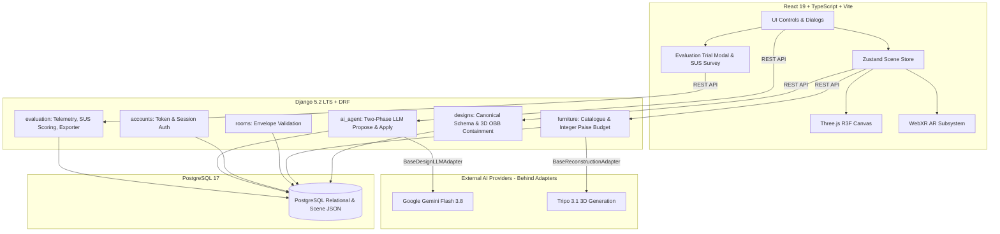

# RoomGenie AI

An AI-Agent-Assisted Interior Design System combining interactive 3D furniture placement, room-photo analysis, budget-aware recommendations, optional photo-to-3D reconstruction, and WebXR AR visualization.

> **Project Type:** Solo B.Tech CSE Project (Gourav Sharma)<br>
> **Status:** Phase 8.4 Verified & Closed; Phase 8.5 (Research Readiness Gate & Analysis Plan Lock) Complete & Ready for Review<br>
> **Visual Verification:** See [docs/SCREENSHOTS.md](docs/SCREENSHOTS.md) for live browser screenshots and [docs/MANUAL_AR_TESTING_PROTOCOL.md](docs/MANUAL_AR_TESTING_PROTOCOL.md) for physical AR device test logs.

---

> [!IMPORTANT]
> **Research Ethics & Telemetry Governance:**
> - `ENABLE_EVALUATION_TELEMETRY=False` remains the default across all environments. Telemetry recording is only activated when explicitly configured for approved user studies.
> - Participant recruitment remains strictly **PAUSED** pending formal institutional ethics committee review.
> - Automated software verification (241 Django backend tests and 143 frontend Vitest tests) confirms engineering correctness but does **not** constitute ethics clearance or empirical human-subject findings.
> - All empirical thesis tables, effect sizes, and results remain unpopulated placeholders until formal approval and actual participant trials.

---

## Technical Stack & Locked Decisions

- **Frontend:** React 19 + TypeScript + Vite + Tailwind CSS v4 (143 Vitest unit/integration tests)
- **3D Engine:** Three.js + React Three Fiber + Drei (Phase 1)
- **Backend:** Python 3.12 + Django 5.2 LTS + Django REST Framework + CORS Headers (241 Django unit/integration tests)
- **Database:** PostgreSQL 17 (authoritative relational & canonical scene persistence)
- **AI Baselines:** 
  - LLM & Spatial Reasoning: Google Gemini API (`gemini-3.8-flash`) behind `BaseDesignLLMAdapter`, deterministic `MockDesignLLMAdapter` default in dev/tests
  - Room Photo Vision: Google Gemini API (`gemini-3.8-flash`) behind `BaseRoomVisionAdapter`, deterministic `MockRoomVisionAdapter` default in dev/tests
  - Photo-to-3D: Tripo API (`v3.1-20260211`) behind `BaseReconstructionAdapter`, deterministic `MockReconstructionAdapter` with catalogue fallback
  - Currency: Indian Rupee (₹, INR) with deterministic backend integer paise arithmetic
- **Evaluation & Telemetry:**
  - Standardized 10-item System Usability Scale (SUS) with strict key/rating validation (Phase 8.3)
  - Server-authoritative geometric collision proxies and keep-out doorway clearance metrics (Phase 8.2)
  - Dataset export engine (`export_evaluation_dataset`) supporting research-ready CSV and JSON formats

---

## Project Structure

```text
roomgenie-ai/
├── .agents/                    # Agent instructions and domain rules
│   └── rules/                  # Frontend, backend, and AI/media rules
├── .env.example                # Template for local environment variables
├── .gitignore                  # Git ignore rules (secrets, virtualenv, node_modules, media)
├── docker-compose.yml          # Containerized PostgreSQL service (port 5433 on loopback)
├── AGENTS.md                   # Autonomous agent behavior guidelines
├── plan.md                     # Comprehensive 14-week implementation plan
├── ARCHITECTURE.md             # Canonical scene schema & architectural contracts
├── ASSET_LICENSES.md           # Verifiable CC0 1.0 Universal asset licensing
├── MODEL_AND_TECH_DECISIONS.md # Locked tech stack & provider decisions
├── HUMAN_SETUP.md              # Human-owned actions & approval boundaries
├── RESEARCH_PLAN.md            # Empirical research study protocol & metrics
├── DEVELOPMENT_CHECKLIST.md    # Milestone definition of done & verification checklist
├── docs/                       # Research documentation, guides, and screenshot gallery
│   ├── RESEARCH_DECISION_REGISTER.md          # 21 cataloged design, statistical, and ethical decisions
│   ├── STATISTICAL_ANALYSIS_PLAN.md           # Pre-registered SAP: models, diagnostics, FWER control
│   ├── RESEARCH_DATA_QUALITY_CHECKLIST.md     # 11-dimensional pre-/post-collection data audit checklist
│   ├── ETHICS_AND_DATA_GOVERNANCE_GATE.md     # Institutional pre-clearance gate, consent, data minimization
│   ├── SUPERVISOR_REVIEW_PACKAGE.md           # Unified supervisor review dossier & ethics submission materials
│   ├── PHASE_8_5_RESEARCH_READINESS_REPORT.md # Executive readiness synthesis & precision audit verdict
│   ├── THESIS_SYNTHESIS_AND_REPORT_OUTLINE.md # 12-chapter B.Tech thesis outline & LMM/GLMM models
│   ├── EVALUATION_DATASET_AND_EXPORT_GUIDE.md # CLI export workflow, CSV/JSON schema specification
│   ├── RESEARCH_PROTOCOL_AND_TASKS.md         # Within-subject crossover protocol, Latin square, rubrics
│   ├── AR_DEVICE_SPECIFICATION.md             # Mobile WebXR hardware target & physical verification log
│   ├── MANUAL_AR_TESTING_PROTOCOL.md          # Step-by-step physical AR test procedure & checklist
│   ├── SCREENSHOTS.md                         # Screenshot gallery with test descriptions
│   └── screenshots/                           # Verified browser and mobile test screenshots
├── frontend/                   # React + TypeScript + Vite client
│   ├── src/
│   │   ├── services/           # Typed API clients (health check, designApi, evaluationApi, etc.)
│   │   ├── components/
│   │   │   ├── editor/         # Viewport headers, palettes, persistence modals, help dialogs
│   │   │   └── evaluation/     # Trial modal, task briefing, SUS survey, post-task feedback
│   │   ├── editor3d/           # Three.js Canvas, Zustand store, scene validation, WebXR runtime
│   │   ├── App.tsx             # System dashboard & 3D Editor
│   │   └── App.test.tsx        # Vitest & React Testing Library test suite (143 tests)
│   ├── package.json
│   └── vite.config.ts
└── backend/                    # Django REST Framework backend
    ├── config/                 # Project configuration (settings, urls, views, tests)
    │   ├── settings.py         # Environment-based PostgreSQL settings & telemetry flags
    │   ├── urls.py             # API routing (/api/v1/health/, /auth/, /rooms/, /furniture/, /designs/, /agent/, /evaluation/)
    │   ├── views.py            # Health check endpoint
    │   └── tests.py            # DRF APIClient health tests
    ├── apps/                   # Modular monolith Django applications
    │   ├── accounts/           # Token authentication, registration, demo user auth
    │   ├── rooms/              # Room envelope models, serializers, CRUD viewsets
    │   ├── furniture/          # Catalogue models, seed data command, search viewsets, budget engine
    │   ├── designs/            # Scene JSON persistence, canonical schema validation, CRUD, cloning
    │   ├── ai_agent/           # Two-phase LLM agent, tool-calling simulation, Gemini Flash adapter
    │   └── evaluation/         # Research telemetry, SUS scoring, session persistence, dataset exporter
    ├── manage.py
    └── requirements.txt        # Pinned Python dependencies
```

---

## Local Setup & Run Instructions (Windows / PowerShell)

### Prerequisites Check

Ensure you have installed:
- Git 2.46+
- Node.js v20+ (v24 tested) & npm
- Python 3.12+
- PostgreSQL 17 (or Docker Desktop)

### 1. Environment Configuration

Copy the example environment template into `.env`:
```powershell
Copy-Item .env.example .env
```
Update `.env` with your local PostgreSQL password:
```ini
DB_PASSWORD=your_local_postgres_password
```

### 2. Frontend (React + Vite)

From the project root:
```powershell
cd frontend
npm install
npm run dev
```
- Frontend dev server starts at: `http://localhost:5173/`

Run tests, type check, lint, and build:
```powershell
npm run test       # Run Vitest test suite (143 tests passing)
npm run typecheck  # Run TypeScript compiler check
npm run lint       # Run Oxlint
npm run build      # Build production bundle
```

### 3. Backend (Django REST Framework)

From the project root:
```powershell
cd backend
python -m venv .venv
.\.venv\Scripts\Activate.ps1
pip install -r requirements.txt
```

Run checks, migrations, seed catalogue, and tests:
```powershell
python manage.py check               # Django system checks
python manage.py migrate             # Run database migrations
python manage.py seed_furniture      # Seed 10 architectural CC0 furniture catalogue assets
python manage.py test                # Run full Django test suite (241 tests passing across all apps)
```

Start the development server:
```powershell
python manage.py runserver 127.0.0.1:8000
```
- Health endpoint: `http://127.0.0.1:8000/api/v1/health/`
- Auth endpoints: `http://127.0.0.1:8000/api/v1/auth/` (`register/`, `login/`, `me/`, `demo/` [gated by `ALLOW_DEMO_AUTH = DEBUG and ...`; 403 in production])
- Room envelopes CRUD: `http://127.0.0.1:8000/api/v1/rooms/`
- Furniture catalogue: `http://127.0.0.1:8000/api/v1/furniture/` (with category, style_tags, dimension, and price range filtering)
- Deterministic budget estimate: `http://127.0.0.1:8000/api/v1/budgets/estimate/` (integer paise calculation with 3D room containment validation)
- Room designs persistence: `http://127.0.0.1:8000/api/v1/designs/` (`{id}/duplicate/`)
- AI Agent endpoints: `http://127.0.0.1:8000/api/v1/agent/prompt/` and `/apply/` (two-phase proposal/approval)
- Evaluation Telemetry endpoints: `http://127.0.0.1:8000/api/v1/evaluation/sessions/` (`checkpoints/`, `complete/`, `abort/`)

### 4. Running Database with Docker Compose (Recommended Alternative)

To run containerized PostgreSQL 17 without port collisions on machines with native PostgreSQL on port 5432, Docker Compose exposes port `5433` on loopback `127.0.0.1`:
```powershell
docker compose up -d postgres
```
Ensure `.env` matches with `DB_PORT=5433` (configured as default in `.env.example`).

### 5. Research Evaluation Dataset Export

To export anonymized evaluation sessions for statistical analysis:
```powershell
# Export completed sessions to research-ready CSV (33 columns)
python manage.py export_evaluation_dataset --format=csv --status=completed --output=data/completed_sessions.csv

# Export completed sessions to hierarchical JSON (including checkpoint histories)
python manage.py export_evaluation_dataset --format=json --status=completed --output=data/completed_sessions.json

# Export all sessions (completed, aborted, and in_progress) for attrition and dropout analysis
python manage.py export_evaluation_dataset --format=csv --output=data/evaluation_all_sessions.csv
```
*Note: For full schema documentation, field derivations, and sample exports, refer to [docs/EVALUATION_DATASET_AND_EXPORT_GUIDE.md](docs/EVALUATION_DATASET_AND_EXPORT_GUIDE.md).*

---

## Progress Tracker

- [x] **Phase 0 — Setup and scaffold**
  - OS and environment inspection (Git, Node, Python, PostgreSQL, Docker)
  - React + TypeScript + Vite + Tailwind CSS frontend scaffold
  - Vitest + Testing Library tests passing
  - Django + DRF backend with environment-based PostgreSQL settings
  - Health check endpoint `/api/v1/health/` and unit test suite
  - Locked tech stack verification & mock provider configurations
- [x] **Phase 1 — Interactive 3D room editor**
  - Three.js + React Three Fiber + Drei interactive canvas with architectural lighting
  - Editable room boundary envelope in metres with real-time floor grid
  - OrbitControls with reset camera and 2D floor-plan / 3D perspective switcher
  - 5 legally cleared architectural furniture assets with verifiable CC0 attribution ([`ASSET_LICENSES.md`](ASSET_LICENSES.md))
  - Real binary glTF models (`sofa.glb`, `coffee_table.glb`, `desk.glb`) with procedural Three.js geometry fallbacks
  - Interactive selection, translation, rotation (+45/-45/90/180/slider), and scale clamping
  - Real-time room boundary clamping preventing out-of-bounds clipping and non-positive dimension rejection
  - Material swatch color customization with preserved roughness and metalness overrides
  - Keyboard shortcuts (Delete, Backspace, Esc) and comprehensive navigation guide modal
- [x] **Phase 2 — Django API and persistence**
  - Modular monolith Django apps: `accounts`, `rooms`, `furniture`, `designs`
  - Relational models on PostgreSQL 17: `User`, `Room`, `FurnitureAsset`, `Design`
  - DRF Token & Session Authentication with strict user-level ownership isolation (404 on cross-user queries)
  - Development-only demo authentication endpoint (`/api/v1/auth/demo/` gated by `ALLOW_DEMO_AUTH = DEBUG and ...`; strictly returns 403 Forbidden in production)
  - Authoritative canonical scene schema validation (`schemaVersion`, metric units, room dimensions, object transforms)
  - Exact 3D transformed oriented bounding box (OBB) extents containment: validates dimensions, scale, Euler XYZ rotation matrix, position, floor boundary ($Y_{min} \ge 0$), ceiling boundary ($Y_{max} \le \text{height}$), and lateral room walls
  - Full CRUD endpoints: `/api/v1/rooms/`, `/api/v1/furniture/`, `/api/v1/designs/` with design cloning (`duplicate`)
  - Initial catalogue seed command (`seed_furniture`)
  - Frontend persistence service ([`frontend/src/services/designApi.ts`](frontend/src/services/designApi.ts)) & Save/Load UI modal
- [x] **Phase 3 — Furniture catalogue and budget**
  - Expanded catalogue model with 10 architectural models across seating, tables, storage, beds, and decor
  - Multi-attribute filtering in `FurnitureAssetViewSet`: category, style tags, keyword search, price range (`min_price`, `max_price`), and dimension compatibility (`max_width`, `max_depth`, `max_height`)
  - Deterministic backend budget estimation engine (`POST /api/v1/budgets/estimate/` in `apps/furniture/budget.py`) using integer paise math (minor units) to prevent floating-point rounding errors
  - Category subtotals, itemized pricing, and explicit handling of unpriced custom assets (`price_paise: None` rendered as "Price on Request" without invented prices)
  - Full transformed 3D room containment validation in budget estimates to detect out-of-bounds furniture
  - Enhanced frontend `FurniturePalette.tsx` with live search, category tabs, style filter pills, budget slider, and API fallback
  - Interactive `BudgetBreakdownModal.tsx` showing authoritative calculation, category subtotals, and room envelope compliance
- [x] **Phase 4 — AI interior-design agent**
  - Modular `apps/ai_agent` application with `AgentSession` and `AgentRun` persistence
  - Configurable adapter architecture: `BaseDesignLLMAdapter` interface with Google Gemini API adapter (`gemini-3.8-flash`) and offline deterministic `MockDesignLLMAdapter` active by default in dev/tests
  - Strictly allowlisted typed actions (`add_furniture`, `move_object`, `replace_furniture`, `remove_object`, `set_material`, `clear_room`); zero execution of arbitrary code, SQL, shell, or unrestricted HTTP
  - Deterministic pre-flight simulation engine (`validate_and_simulate_actions`) computing 3D room containment and integer paise budget impact before persistence
  - Two-phase approval workflow: `/prompt/` proposes structured modifications without mutating the design; scene changes are applied only upon explicit user approval via `/apply/`
  - Strict user-ownership isolation (sessions and runs isolated by `owner=request.user`, 404 for cross-user queries)
  - Interactive frontend slide-out `AiAgentDrawer.tsx` with conversation history, suggested prompt chips, structured proposal preview card, authoritative budget impact, and Approve/Discard controls
- [x] **Phase 5 — Room photo analysis**
  - Gemini Flash vision adapter (`GeminiRoomVisionAdapter`) and deterministic mock adapter (`MockRoomVisionAdapter`)
  - Structured room layout observation: furniture detection mapped to CC0 catalogue, architectural features, palette, confidence scoring, uncertainty notes
  - Two-stage confirmation modal (`RoomPhotoVisionModal.tsx`) with drag-and-drop photo upload, observations review, catalogue remapping, and explicit user application
- [x] **Phase 6 — Photo-to-3D furniture approximation**
  - Asynchronous reconstruction pipeline with Tripo adapter (`v3.1-20260211`), deterministic mock engine, and catalogue fallback
  - Strict Khronos glTF 2.0 binary (`.glb`) validator with header, chunk, and bounds enforcement
  - Authenticated streaming endpoint (`GET /api/v1/furniture/reconstructions/{id}/download/`) with path traversal protection and secure in-memory streaming
  - End-to-end asset lifecycle verified across placement, backend persistence, rehydration, duplication, and deletion
- [x] **Phase 7 — Real-world AR placement (Physically Verified on Target Hardware)**
  - Reference hardware specification ([`docs/AR_DEVICE_SPECIFICATION.md`](docs/AR_DEVICE_SPECIFICATION.md)) targeting Android 10+ ARCore and iOS 15+ Quick Look
  - Three.js WebXR runtime (`webXrArSession.ts`) with `immersive-ar` mode, viewer space `XRHitTestSource`, real-time animation loop, reticle tracking, and tap-to-place
  - Interactive AR placement dialog (`ArPlacementModal.tsx`) with dynamic surface detection HUD, manual adjustments (floor offset, 360° yaw rotation, 0.5x–2.0x scale), and active session controls
  - Mobile handoff route (`?ar=true&designId=...&assetId=...`) restoring user authentication, design scene, and auto-opening AR flow on mobile
  - Private authenticated reconstruction protection: Google Scene Viewer suppressed for private assets to preserve authorization boundaries
  - Physically tested and verified on `realme Narzo 70 Turbo 5G` (Android 14, ARCore 1.52.x, Chrome 145.x) with step-by-step logs in [`docs/MANUAL_AR_TESTING_PROTOCOL.md`](docs/MANUAL_AR_TESTING_PROTOCOL.md)
- [x] **Phase 8.1 — Research Protocol & Task Design**
  - $2 \times 2$ Within-Subject Crossover experimental design (Manual vs. AI-Agent-Assisted)
  - Latin square counterbalancing across condition order and task sequences
  - Formal task specifications (Task 1: Bedroom Suite, Task 2: Home Office) with budget traps and keep-out doorway clearances
  - Documented in [`docs/RESEARCH_PROTOCOL_AND_TASKS.md`](docs/RESEARCH_PROTOCOL_AND_TASKS.md)
- [x] **Phase 8.2 — Evaluation Telemetry & Metrics API**
  - Modular `apps/evaluation/` Django application with `EvaluationSession` and `SessionCheckpoint` persistence
  - Server-authoritative metrics calculation: AABB overlap pairs, silent doorway keep-out intrusions, attempted boundary violations, debounced manual edits, undo/redo count
  - Standardized 10-item System Usability Scale (SUS) survey engine computing Brooke composite scores ($0–100$)
  - Checkpoint tracking capturing scene snapshots for dropout and progression analysis
- [x] **Phase 8.3 — Strict Backend SUS Validation**
  - Hardened survey response validation in `backend/apps/evaluation/`:
    - Strict rejection of boolean question keys and boolean ratings
    - Non-numeric and non-finite values rejected with clear 400 Bad Request messages
    - Fractional ratings rejected; normalization occurs strictly after validation
    - Duplicate key detection preventing shadowed invalid ratings across string/integer representation
  - Verified by 42 evaluation unit tests, 241 full backend tests, and 143 frontend Vitest tests
- [x] **Phase 8.4 — Research Documentation, Thesis Synthesis & Report Preparation**
  - System-wide documentation audit and alignment with implementation reality
  - 12-chapter B.Tech CSE thesis structure ([`docs/THESIS_SYNTHESIS_AND_REPORT_OUTLINE.md`](docs/THESIS_SYNTHESIS_AND_REPORT_OUTLINE.md))
  - Research methodology, LMM and GLMM statistical modeling specifications, and Holm-Bonferroni correction
  - Dataset export guide and reproducibility appendix ([`docs/EVALUATION_DATASET_AND_EXPORT_GUIDE.md`](docs/EVALUATION_DATASET_AND_EXPORT_GUIDE.md))
- [x] **Phase 8.5 — Research Readiness Gate & Analysis Plan Lock (Ready for Supervisor Review)**
  - Research decision register cataloging 21 protocol, design, statistical, and ethical decisions ([`docs/RESEARCH_DECISION_REGISTER.md`](docs/RESEARCH_DECISION_REGISTER.md))
  - Formal Statistical Analysis Plan (SAP) locking $H_{01}..H_{04}$, LMM/GLMM models, diagnostics, and Holm-Bonferroni correction ([`docs/STATISTICAL_ANALYSIS_PLAN.md`](docs/STATISTICAL_ANALYSIS_PLAN.md))
  - 11-dimensional research data quality and integrity checklist ([`docs/RESEARCH_DATA_QUALITY_CHECKLIST.md`](docs/RESEARCH_DATA_QUALITY_CHECKLIST.md))
  - Pre-clearance ethics and data governance gate with paused participant recruitment ([`docs/ETHICS_AND_DATA_GOVERNANCE_GATE.md`](docs/ETHICS_AND_DATA_GOVERNANCE_GATE.md))
  - Executive research readiness report and precision audit verdict ([`docs/PHASE_8_5_RESEARCH_READINESS_REPORT.md`](docs/PHASE_8_5_RESEARCH_READINESS_REPORT.md))
- [x] **Phase 8.6 — Supervisor Review Package & Ethics Submission Preparation**
  - Unified Academic Supervisor Review Package & Ethics Submission Dossier ([`docs/SUPERVISOR_REVIEW_PACKAGE.md`](docs/SUPERVISOR_REVIEW_PACKAGE.md))
  - Research protocol, Latin square counterbalancing, and confirmatory hypotheses ($H_{01} \dots H_{04}$)
  - Formal presentation of isolated pending supervisor decisions (`DEC-13`, `DEC-14`, `DEC-15`)
  - Complete 21-decision research register, 11-dimensional data quality checklist, and export guide
  - Draft Participant Information Sheet (PIS) and Informed Consent Form (ICF) with 14-day withdrawal right
  - Explicit checklist of outstanding institutional ethics approvals and pre-study requirements
- [ ] **Empirical Phase — Participant Study & Final Thesis Defense**
  - Institutional ethics committee review and clearance (Prerequisite)
  - Target-hardware end-to-end dry run (Post-ethics, Pre-collection)
  - Counterbalanced participant study ($N=30$, 60 completed sessions)
  - Statistical analysis and empirical thesis submission

---

## System Architecture & Component Responsibilities



- **Frontend (Client):** Manages local interactive manipulation, real-time boundary clamping, raycasting, camera control, and WebXR hit-testing.
- **Backend (Server):** Authoritative for data integrity, ownership verification, 3D transformed OBB room containment, deterministic budget calculation, AI proposal validation, and research telemetry scoring.
- **AI Adapters:** Abstract provider-specific protocols behind clean interfaces (`BaseDesignLLMAdapter`, `BaseRoomVisionAdapter`, `BaseReconstructionAdapter`), allowing seamless toggling between live cloud APIs and deterministic offline mock engines.

---

## Known Limitations, Security Assumptions, and Privacy Boundaries

1. **AI Non-Determinism & Two-Phase Approval:**
   LLM proposals are treated as untrusted suggestions. The model never executes arbitrary code, SQL queries, or filesystem modifications. All proposed actions are parsed into strictly typed allowlisted structures, pre-flight simulated against spatial boundaries and budget ceilings, and executed **only** upon explicit user confirmation.
2. **Private Media Isolation:**
   Uploaded room photos and private generated 3D models are stored in non-public media directories. Downloads require authenticated token credentials. To prevent unauthorized transmission of private reconstructions to third-party servers, Google Scene Viewer is intentionally bypassed for private user assets.
3. **Mobile WebXR Constraints:**
   AR surface tracking via `immersive-ar` relies on device visual-inertial odometry. Tracking fidelity degrades under low ambient lighting, textureless floors (e.g. uniform glossy tiles), and rapid camera movement.
4. **Deterministic Financial Math:**
   All furniture pricing and budget totals are calculated using integer minor units (paise) on the backend. Custom or unpriced assets are explicitly rendered as "Price on Request" without hallucinated costs.
5. **Research Telemetry & Privacy:**
   Evaluation telemetry records interaction timestamps, debounced edit counts, and transformed coordinate snapshots strictly when `ENABLE_EVALUATION_TELEMETRY=True`. No biometric data, private chat text outside agent commands, or webcam video feeds are ever captured or persisted.
