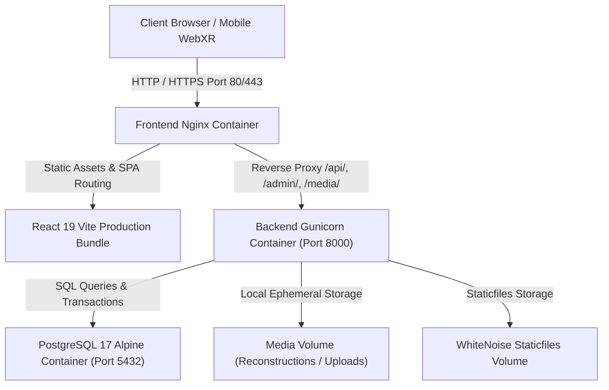

# RoomGenie AI — Production Deployment and Operations Guide

This document defines the deployment architecture, operational procedures, environment configuration, and demonstration runbook for **RoomGenie AI**.

---

## 1. System Architecture and Deployment Topology

RoomGenie AI is architected as an authoritative **modular monolith** with a decoupled React SPA frontend and a Django REST Framework backend:



### Container Responsibilities

| Container | Base Image | Role | Exposed Ports | Health Check |
|---|---|---|---|---|
| `roomgenie_frontend_prod` | `nginx:1.27-alpine` | Serves optimized React 19 SPA, caches 3D GLB models, reverse proxies `/api/`, `/admin/`, and `/media/`. | `80:80` (or host `$PORT`) | `wget -q --spider http://127.0.0.1/` |
| `roomgenie_backend_prod` | `python:3.12-slim` | Authoritative Django REST Framework API running under Gunicorn with WhiteNoise middleware. | Internal `8000` | `curl -f http://127.0.0.1:8000/api/v1/health/` |
| `roomgenie_postgres_prod` | `postgres:17-alpine` | Primary transactional relational database storing rooms, designs, furniture catalogue, and user accounts. | Internal `5432` | `pg_isready -U roomgenie_user` |

---

## 2. Environment Configuration Reference

The application strictly separates configuration from code via environment variables.

| Variable | Default (Dev) | Production Recommendation | Description |
|---|---|---|---|
| `DJANGO_DEBUG` | `True` | `False` | Disables debug mode and Django traceback exposure. |
| `DJANGO_SECRET_KEY` | *(dev key)* | *50+ character random secret* | Cryptographic signing key. Mandatory non-default when `DJANGO_DEBUG=False`. |
| `DJANGO_ALLOWED_HOSTS` | `localhost,127.0.0.1` | `yourdomain.com,api.yourdomain.com,backend` | Comma-separated list of valid host/domain names. |
| `DB_ENGINE` | `django.db.backends.postgresql` | `django.db.backends.postgresql` | Authoritative database engine. (`sqlite3` supported for offline tests). |
| `DB_NAME` | `roomgenie_db` | `roomgenie_db` | PostgreSQL database name. |
| `DB_USER` | `postgres` | `roomgenie_user` | PostgreSQL database user. |
| `DB_PASSWORD` | *(empty)* | *Strong unique password* | Password required in production when `DJANGO_DEBUG=False`. |
| `DB_HOST` | `127.0.0.1` (or `postgres`) | `postgres` | Hostname of PostgreSQL service. |
| `DB_PORT` | `5433` (local) / `5432` (Docker) | `5432` | Internal PostgreSQL port. |
| `CORS_ALLOWED_ORIGINS` | `http://localhost:5173` | `https://yourdomain.com,http://localhost` | Allowed web browser origins for cross-origin requests. |
| `AI_PROVIDER_MODE` | `mock` | `mock` or `live` | LLM design agent mode (`mock` runs deterministic local planner; `live` connects to Gemini). |
| `ROOM_VISION_PROVIDER_MODE` | `mock` | `mock` or `live` | Room photo analysis provider. |
| `IMAGE_TO_3D_PROVIDER_MODE` | `mock` | `mock` or `tripo` | 3D reconstruction mode (`mock` provides instant architectural meshes). |
| `IMAGE_TO_3D_ALLOW_PAID_REQUESTS` | `false` | `false` | Gate requiring explicit approval before external API costs are incurred. |
| `ENABLE_EVALUATION_TELEMETRY` | `False` | `False` | **Strict research governance**: Must remain `False` unless institutional ethics approval is active. |
| `GUNICORN_WORKERS` | `3` | `(2 x CPU Cores) + 1` | Number of concurrent WSGI worker processes. |
| `GUNICORN_THREADS` | `2` | `2` | Number of worker threads per process. |
| `VITE_API_URL` | `http://localhost:8000` | `""` (empty for same-origin proxy) | API base URL for frontend compilation. |

---

## 3. Production Deployment with Docker Compose

### Step 1: Clone Repository and Prepare Environment File

```bash
git clone https://github.com/GouravSharma26/RoomGenie-ai.git
cd roomgenie-ai

# Create production environment file from template
cp .env.example .env.production
```

# Generate a secure 50+ character secret key:
# python -c "import secrets; print(secrets.token_urlsafe(50))"

Configure the production secrets in `.env.production`:
```env
DJANGO_DEBUG=False
DJANGO_SECRET_KEY=k7B_9vM2xL4qP9wZ1yD8fG3jR6tV5nC0mX7sA4eQ2wE8rT1yU9iO5pA3sD7fG1hJ4
DJANGO_ALLOWED_HOSTS=localhost,127.0.0.1,backend,frontend

DB_ENGINE=django.db.backends.postgresql
DB_NAME=roomgenie_db
DB_USER=roomgenie_user
DB_PASSWORD=rG_p9!s3cure_db_pass_2026_prod
DB_HOST=postgres
DB_PORT=5432

CORS_ALLOWED_ORIGINS=http://localhost,http://127.0.0.1

AI_PROVIDER_MODE=mock
ROOM_VISION_PROVIDER_MODE=mock
IMAGE_TO_3D_PROVIDER_MODE=mock
IMAGE_TO_3D_ALLOW_PAID_REQUESTS=false

ENABLE_EVALUATION_TELEMETRY=False
```

### Step 2: Build and Launch Containers

```bash
docker compose -f docker-compose.prod.yml --env-file .env.production up -d --build
```

The container entrypoint (`backend/entrypoint.sh`) automatically performs:
1. Database connectivity polling until PostgreSQL is healthy.
2. `python manage.py migrate --noinput` to create all database schemas.
3. `python manage.py collectstatic --noinput --clear` to gather static assets.
4. `python manage.py seed_furniture` to initialize the architectural furniture catalogue.
5. Launches Gunicorn with 3 worker processes.

### Step 3: Verify Health Checks and Connectivity

```bash
# Verify container states
docker compose -f docker-compose.prod.yml ps

# Check backend health check endpoint via frontend reverse proxy
curl -i http://localhost/api/v1/health/
```

Expected JSON response:
```json
{
  "status": "ok",
  "service": "RoomGenie AI Backend",
  "version": "0.1.0",
  "database": "connected",
  "timestamp": "2026-10-27T18:00:00.000000+00:00"
}
```

### Step 4: Create Admin Superuser (Optional)

```bash
docker compose -f docker-compose.prod.yml exec backend python manage.py createsuperuser
```

The Django Admin interface is accessible at `http://localhost/admin/`.

---

## 4. Standalone Local Development (Without Production Docker)

For rapid local iterative development, you can run the services directly on your host machine:

### Option A: Local Backend with SQLite Fallback (Zero Dependencies)

```bash
cd backend
python -m venv .venv
source .venv/bin/activate  # Or on Windows: .venv\Scripts\activate
pip install -r requirements.txt

# Run migrations on local SQLite
export DB_ENGINE=django.db.backends.sqlite3
python manage.py migrate
python manage.py seed_furniture
python manage.py runserver 8000
```

### Option B: Local Backend with Docker PostgreSQL

```bash
# Start PostgreSQL on port 5433
docker compose up postgres -d

# Start Django Backend
cd backend
python manage.py migrate
python manage.py seed_furniture
python manage.py runserver 8000
```

### Start Frontend Dev Server

```bash
cd frontend
npm install
npm run dev
```

Open `http://localhost:5173` in your browser.

---

## 5. End-to-End Live Demonstration Workflow

Use this 12-step sequence for project examinations, live evaluations, and presentations:

1. **Launch & Verification**:
   - Navigate to `http://localhost/` in Google Chrome or Microsoft Edge.
   - Observe the System Status indicator displaying a green checkmark (`Backend Connected`).
2. **Room Creation & Geometry**:
   - Click **Create Design** or select the default room.
   - Adjust room width ($4.0\text{ m}$), length ($5.0\text{ m}$), and height ($2.8\text{ m}$) using the dimension controls.
   - Observe real-time 3D floor plan geometry updating in Three.js coordinates ($Y\text{ up}$, $X/Z\text{ ground plane}$).
3. **Doorway & Keep-Out Zones**:
   - Verify that the designated doorway clearance zone is rendered with visible visual boundary guides.
4. **Catalogue Browsing**:
   - Open the **Furniture Catalogue** sidebar.
   - Filter by categories: *Seating*, *Tables*, *Storage*.
   - Filter by styles: *Modern*, *Scandinavian*, *Industrial*.
5. **Interactive 3D Placement**:
   - Click **Add to Room** on the *Modern 3-Seater Sofa* ($\text{₹}29,999.00$).
   - The asset loads from `/models/sofa.glb` and renders at ground level.
6. **Manipulation & Transformation**:
   - Select the placed sofa.
   - Use the transformation gizmo to translate along the $X/Z$ plane.
   - Rotate the sofa $90^\circ$ around the vertical $Y$-axis.
7. **Spatial Containment & Collision Enforcement**:
   - Drag the furniture toward the outer perimeter walls.
   - Observe collision feedback preventing the asset from intersecting walls or exceeding room boundaries.
8. **Real-Time Budget Calculation**:
   - Observe the Budget summary in the top toolbar.
   - Add a *Minimalist Coffee Table* ($\text{₹}8,499.00$) and *Ergonomic Study Desk* ($\text{₹}14,999.00$).
   - Verify deterministic total calculation: $\text{₹}53,497.00$ ($5,349,700\text{ paise}$).
9. **AI Design Agent Proposal**:
   - Open the **AI Design Assistant** panel.
   - Select prompt: *"Create a cozy modern living room layout under ₹60,000"*.
   - Click **Generate Proposal**.
   - Review proposed furniture items, coordinate placements, and budget allocations.
10. **Proposal Approval Gate**:
    - Observe that the proposal is in preview mode and **not applied automatically**.
    - Click **Approve Proposal**. The layout updates immediately.
    - Manually fine-tune the placed coffee table position.
11. **Persistence & Restoration**:
    - Click **Save Design**.
    - Refresh the browser page (`F5`).
    - Verify that all placed furniture models, coordinates, orientations, and custom dimensions restore deterministically from PostgreSQL.
12. **Mobile WebXR / AR Fallback**:
    - Click the **AR View** button.
    - On non-AR desktop browsers, verify the graceful compatibility alert explaining WebXR requirements and offering QR code mobile handoff.

---

## 6. Operations, Backup, and Maintenance

### Viewing Real-Time Container Logs

```bash
# View backend logs (including Gunicorn and Django access logs)
docker compose -f docker-compose.prod.yml logs -f backend

# View Nginx access and error logs
docker compose -f docker-compose.prod.yml logs -f frontend
```

### PostgreSQL Database Backups

```bash
# Create timestamped SQL dump
docker compose -f docker-compose.prod.yml exec -T postgres \
    pg_dump -U roomgenie_user roomgenie_db > backup_$(date +%Y%m%d_%H%M%S).sql

# Restore from SQL dump
cat backup_20261027_120000.sql | docker compose -f docker-compose.prod.yml exec -T postgres \
    psql -U roomgenie_user -d roomgenie_db
```

### Ephemeral Photo Cleanup

Room photos uploaded for vision analysis are subject to a 1-hour retention policy. To manually trigger cleanup:
```bash
docker compose -f docker-compose.prod.yml exec backend python manage.py cleanup_expired_photos
```

---

## 7. Troubleshooting Matrix

| Issue | Root Cause | Resolution |
|---|---|---|
| Frontend displays `Backend Unreachable` | Backend container is starting or crashed. | Check `docker compose logs backend`. Verify PostgreSQL health check passes. |
| `DJANGO_SECRET_KEY must be securely configured` | `DJANGO_DEBUG=False` with default secret key. | Set a secure non-default `DJANGO_SECRET_KEY` in `.env.production`. |
| 403 Forbidden on API calls | Missing CORS origin or CSRF header. | Ensure browser origin is listed in `CORS_ALLOWED_ORIGINS`. In reverse proxy mode, accessing via port 80 avoids CORS entirely. |
| 3D models fail to render | Missing `.glb` files in static distribution. | Check `/usr/share/nginx/html/models/` in frontend container. Verify `coffee_table.glb`, `desk.glb`, `sofa.glb` are present. |
| Database connection refused on port 5433 | Native PostgreSQL already bound to 5432/5433. | Use `docker-compose.prod.yml` which communicates over internal Docker bridge network without host port collision. |
