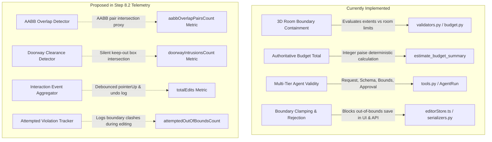

# RoomGenie AI — Research Protocol, Experimental Tasks & Evaluation Instruments

**Milestone:** Phase 8 — Research, Evaluation, and Delivery  
**Document Status:** Complete Experimental Protocol (Pre-Pilot Baseline)  
**Related Documents:** [RESEARCH_PLAN.md](file:///c:/Gourav%20Sharma/VR%20Project/roomgenie-ai/RESEARCH_PLAN.md), [ARCHITECTURE.md](file:///c:/Gourav%20Sharma/VR%20Project/roomgenie-ai/ARCHITECTURE.md), [ASSET_LICENSES.md](file:///c:/Gourav%20Sharma/VR%20Project/roomgenie-ai/ASSET_LICENSES.md)

---

## 1. Study Overview & Research Questions

### 1.1 Context
RoomGenie AI combines interactive 3D WebGL room editing, deterministic budget tracking, multi-tier AI tool calling with a two-phase proposal/approval workflow, and optional photo-to-3D asset approximation. This protocol defines the experimental methodology to evaluate whether AI-assisted 3D room design meaningfully changes task completion time, constraint compliance, perceived usability, and user agency compared to manual design.

### 1.2 Research Questions & Hypotheses
- **Primary Research Question (RQ1):**  
  *Does an AI-assisted interactive 3D interior design workflow change completion time, task success, budget compliance, and perceived usability compared with manual use of the same 3D editor?*

#### Primary Confirmatory Hypotheses & Model-Adjusted Statistical Decision Rules
The study evaluates four primary confirmatory hypotheses. Because each participant performs one task under Condition A (Manual) and the other task under Condition B (AI-Assisted) in a four-sequence crossover design, raw individual differences combine the workflow effect with intrinsic task differences and trial order. To prevent confounding, all confirmatory hypotheses are evaluated via **pre-registered statistical models that explicitly isolate Condition, Task, and Trial Period/Order**. All confirmatory hypothesis tests are **two-sided** with an overall family-wise significance threshold of $\alpha = 0.05$.

1. **$H_{01}$ (Task Completion Time):** Active task completion time (seconds) does not differ between Manual (Condition A) and AI-Assisted (Condition B) workflows when controlling for task assignment and trial period.
   - *Primary Adjusted Model:* **Linear Mixed-Effects Model (LMM)** with participant random intercept:
     $$Y_{it} = \beta_0 + \beta_{\text{Condition}} \text{Condition}_{it} + \beta_{\text{Task}} \text{Task}_{it} + \beta_{\text{Period}} \text{Period}_{it} + u_i + \epsilon_{it}$$
     where $u_i \sim \mathcal{N}(0, \sigma_u^2)$ accounts for participant skill/speed variance, and $t \in \{1, 2\}$ represents trial order.
   - *Hypothesis Decision Rule:* Test $H_0: \beta_{\text{Condition}} = 0$ using two-sided $t$-statistic with Satterthwaite degrees-of-freedom approximation ($\alpha = 0.05$).
   - *Model Diagnostics & Fallback:* Residual normality evaluated via the **Shapiro-Wilk test** ($\alpha = 0.05$) on model residuals. If residuals severely deviate from normality or display heteroscedasticity, the log-transformed metric $\log(Y)$ is modeled, or a rank-based non-parametric crossover procedure (Koch's crossover rank analysis / Aligned Rank Transform ART-ANOVA) serves as the pre-registered non-parametric substitute.
   - *Effect Size & Descriptive Baseline:* Adjusted mean difference $\beta_{\text{Condition}}$ with 95% CI; raw paired differences ($\Delta = \text{Time}_B - \text{Time}_A$) and Cohen's $d_z$ reported as descriptive unadjusted baselines.

2. **$H_{02}$ (Perceived Usability — SUS Score):** System Usability Scale (SUS) composite score ($0–100$) does not differ between conditions when controlling for task assignment and trial period.
   - *Primary Adjusted Model:* **Linear Mixed-Effects Model (LMM)** with participant random intercept:
     $$\text{SUS}_{it} = \beta_0 + \beta_{\text{Condition}} \text{Condition}_{it} + \beta_{\text{Task}} \text{Task}_{it} + \beta_{\text{Period}} \text{Period}_{it} + u_i + \epsilon_{it}$$
   - *Hypothesis Decision Rule:* Test $H_0: \beta_{\text{Condition}} = 0$ using two-sided $t$-statistic with Satterthwaite approximation ($\alpha = 0.05$).
   - *Model Diagnostics & Fallback:* Normality of residuals evaluated via Shapiro-Wilk ($\alpha = 0.05$). If violated, the rank-based non-parametric crossover procedure (Koch's method / ART-ANOVA) serves as the substitute.
   - *Effect Size & Descriptive Baseline:* Adjusted mean difference $\beta_{\text{Condition}}$ with 95% CI; raw paired differences and Cohen's $d_z$ reported as unadjusted baselines.

3. **$H_{03}$ (Budget Compliance Rate):** The proportion of submitted designs meeting or staying below the assigned budget ceiling ($\text{budgetTotalPaise} \le \text{budgetCeilingPaise}$) does not differ between conditions when accounting for task assignment and trial period.
   - *Primary Adjusted Model:* **Generalized Linear Mixed Model (GLMM)** with logit link (Mixed Logistic Regression) or Generalized Estimating Equations (GEE) with exchangeable working correlation:
     $$\text{logit}(P(\text{Compliant}_{it} = 1)) = \beta_0 + \beta_{\text{Condition}} \text{Condition}_{it} + \beta_{\text{Task}} \text{Task}_{it} + \beta_{\text{Period}} \text{Period}_{it} + u_i$$
   - *Hypothesis Decision Rule:* Test $H_0: \beta_{\text{Condition}} = 0$ via two-sided Wald / score test ($\alpha = 0.05$).
   - *Small-Sample / Separation Contingency Rule:* If GLMM numerical optimization encounters complete/quasi-complete separation or fails to converge stably (SE $> 5.0$) due to small sample size ($N = 20–30$) or high compliance rates, the pre-registered contingency is the **Stratified Cochran-Mantel-Haenszel (CMH) test** or **Exact Conditional Logistic Regression** stratified by sequence group / task. Exact discordant contingency tables and unadjusted McNemar's tests are reported as descriptive baselines.
   - *Effect Size:* Adjusted Odds Ratio $\text{OR}_{\text{Condition}} = \exp(\beta_{\text{Condition}})$ with 95% confidence intervals.

4. **$H_{04}$ (Composite Task Success Rate):** The proportion of fully successful designs—satisfying all 4 mandatory functional furniture items, remaining budget-compliant, and exhibiting zero doorway keep-out clearance intrusions—does not differ between conditions when accounting for task assignment and trial period.
   - *Primary Adjusted Model:* **Generalized Linear Mixed Model (GLMM)** with logit link (Mixed Logistic Regression) controlling for `Task` and `Period`.
   - *Hypothesis Decision Rule:* Test $H_0: \beta_{\text{Condition}} = 0$ via two-sided Wald test ($\alpha = 0.05$).
   - *Small-Sample / Separation Contingency Rule:* If GLMM fails to converge, evaluate via Stratified CMH test or Exact Conditional Logistic Regression stratified by sequence group / task; report exact discordant tables and unadjusted McNemar's test as descriptive statistics.
   - *Effect Size:* Adjusted Odds Ratio $\text{OR}_{\text{Condition}} = \exp(\beta_{\text{Condition}})$ with 95% confidence intervals.

#### Multiple Comparisons Correction (Family-Wise Error Rate Control)
- **Confirmatory Family:** The four confirmatory hypotheses ($H_{01}, H_{02}, H_{03}, H_{04}$) evaluated via their adjusted condition parameter ($\beta_{\text{Condition}}$) constitute the formal family of primary statistical tests.
- **Correction Method:** The **Holm-Bonferroni step-down procedure** (Holm, 1979) will be applied to maintain the family-wise error rate at $\alpha_{\text{FWER}} = 0.05$. Raw $p$-values are ordered $p_{(1)} \le p_{(2)} \le p_{(3)} \le p_{(4)}$ and compared sequentially against critical thresholds $\alpha / (5 - k)$ for $k = 1, 2, 3, 4$ ($\alpha_1 = 0.0125, \alpha_2 = 0.0167, \alpha_3 = 0.025, \alpha_4 = 0.05$).
- **Reporting Standard:** Both unadjusted raw $p$-values and Holm-adjusted $p$-values ($p_{\text{Holm}}$) will be published alongside 95% confidence intervals and effect sizes.

#### Secondary & Exploratory Outcomes
All secondary and exploratory outcomes ($E_1$ through $E_7$) are strictly designated as exploratory. They will be analyzed using descriptive statistics, point estimates, and unadjusted 95% confidence intervals to generate post-hoc insights without asserting confirmatory significance claims:
- **$E_1$ (AABB Overlap Proxy):** Mean count of overlapping furniture Axis-Aligned Bounding Box pairs (`aabbOverlapPairsCount`).
- **$E_2$ (Manual Adjustment Effort):** Discrete manual interaction counts (`totalEdits`) and undo/redo operations (`undoRedoCount`).
- **$E_3$ (Doorway Keep-Out Intrusions):** Count of furniture objects intruding into the silent doorway clearance box (`doorwayIntrusionsCount`).
- **$E_4$ (Attempted Boundary Clashes):** Frequency of attempted boundary drag clashes or invalid AI proposals (`attemptedOutOfBoundsCount`).
- **$E_5$ (AI Agent Multi-Tier Validity):** Tool schema validity (Tier 2), domain constraint validity (Tier 3), and user proposal approval rate (Tier 4).
- **$E_6$ (Subjective Workload & Agency):** Self-reported mental demand, perceived agency, and qualitative preference.
- **$E_7$ (Photo-to-3D Dimensional Error):** Absolute error ($\Delta W, \Delta D, \Delta H$) and Mean Absolute Percentage Error (MAPE) against physical tape measurements.

*Reporting Invariant:* Confirmatory hypotheses are evaluated strictly as stated. If the AI assistant reduces initial placement time but increases post-generation fine-tuning or fails to prevent subtle layout errors, this outcome will be reported transparently as an empirical research finding.

---

## 2. Ethics, Privacy & Governance Requirements

> [!IMPORTANT]
> **Institutional Governance Note & Mandatory Approval Gate:**  
> This protocol specifies the research procedure, consent wording, and data handling safeguards. In accordance with university research standards, **formal supervisor or institutional ethics approval must be recorded in writing before recruiting human participants**. This protocol document alone does not replace formal ethics clearance.
> - **Approval Body:** Departmental Undergraduate Research Review Committee / Project Evaluation Board (Must be confirmed with actual committee / evaluating body prior to recruitment)  
> - **Protocol Status:** Gated — Formal written supervisor approval and verified contact details required prior to enrolling Participant P01.

### 2.1 Contact Information & Pre-Recruitment Verification Gate
> [!WARNING]
> **Pre-Recruitment Contact Verification Gate:**  
> The researcher and supervisor email addresses below currently use example/placeholder domain formats. Prior to initiating participant recruitment or conducting pilot trials, the investigator must verify and substitute active, monitored institutional email addresses, and confirm the specific faculty project supervisor responsible for ethical oversight.

- **Principal Investigator:** Gourav Sharma (Undergraduate Researcher, Dept. of Computer Science & Engineering)  
  *Email:* `gourav.sharma.cse@example.ac.in` *(Placeholder — verify active institutional contact prior to recruitment)*
- **Faculty Project Supervisor:** Project Supervisor / Course Coordinator (Dept. of Computer Science & Engineering)  
  *Email:* `supervisor.cse@example.ac.in` *(Placeholder — verify active institutional contact prior to recruitment)*

### 2.2 Privacy, Data Protection & Scientific Terminology
1. **Coded / Pseudonymized Individual Records:** During active data collection and the withdrawal window, participant data is **coded / pseudonymized**, not irreversibly anonymized. Participants are assigned an alphanumeric code (e.g., `P01`, `P02`). No personal names, personal email addresses, IP addresses, or phone numbers are logged in experimental telemetry tables.
2. **Local Storage & No Private Media Ingestion:** Experimental trials use the pre-configured local 3D catalogue and standardized synthetic rooms. Participants are **never** asked to upload personal home photography to external cloud APIs during the study trials.
3. **Voluntary Participation & Unconditional Withdrawal:** Participation is entirely voluntary. Participants may halt a trial or withdraw their data at any point without explanation or penalty.
4. **Data Retention & Disposal:** Raw pseudonymized JSON interaction logs and survey responses will be stored in an access-restricted project directory and destroyed upon project examination completion.

### 2.3 Withdrawal Procedure & Irreversible Anonymization Deadline
- **Withdrawal Mechanism:** At the beginning of the study, each participant is provided a physical/digital tear-off slip bearing their unique Participant Code (e.g., `P04`). To request data removal, the participant emails either the investigator or the supervisor citing their code. No personal justification is required.
- **Irreversible Anonymization Deadline:** Participants may withdraw their individual trial data within **14 calendar days** of their test session or prior to the final dataset aggregation lock on **November 15, 2026** (whichever occurs first). Prior to this date, data remains coded / pseudonymized and can be individually deleted. On **November 15, 2026**, individual trial logs are compiled into aggregated statistical matrices, linking codes/slips are permanently destroyed, and the dataset becomes **irreversibly anonymized**. Beyond this point, individual trial logs can no longer be disentangled or removed.

---

## 3. Participant Information & Informed Consent

### Participant Information Sheet

**Study Title:** Evaluating an AI-Assisted 3D Interior Design Workflow with Budget and Spatial Constraints  
**Investigator:** Gourav Sharma (`gourav.sharma.cse@example.ac.in` — placeholder, institutional address verified prior to recruitment)  
**Supervisor:** Departmental Project Supervisor (`supervisor.cse@example.ac.in` — placeholder, institutional address verified prior to recruitment)  
**Institution:** Department of Computer Science & Engineering  

**Purpose of the Study:**  
You are invited to participate in a research evaluation comparing two workflows for designing a 3D room layout: (1) manual placement using a 3D web editor, and (2) AI-assisted placement using natural language prompts with interactive approval. The goal is to evaluate usability, task efficiency, and constraint adherence.

**What Will You Be Asked to Do?**  
1. Complete a brief pre-questionnaire regarding your background with 3D/CAD tools and generative AI.
2. Perform two short interior design tasks on a desktop computer using a 3D web application. In one task, you will place furniture manually; in the other, an AI assistant will propose initial layouts which you can review, approve, and adjust.
3. Complete a 10-item usability questionnaire (System Usability Scale) after each condition.
4. Answer three brief concluding questions about your experience. Total estimated duration is 30–40 minutes.

**Risks and Discomforts:**  
There are no physical or psychological risks beyond normal desktop computer usage.

**Confidentiality & Data Protection:**  
All responses and design interactions are recorded under a coded pseudonym (e.g., `P04`). No names or private contact information will be collected, stored, or published. You may withdraw your data using your Participant Code within 14 days of participation (or prior to the irreversible anonymization aggregation lock on November 15, 2026).

---

### Informed Consent Declaration Form

```markdown
[ ] I confirm that I have read and understood the Participant Information Sheet for this study.
[ ] I have had the opportunity to ask questions, and any questions have been answered satisfactorily.
[ ] I understand that my participation is voluntary and that I am free to withdraw at any time without penalty.
[ ] I understand that to withdraw my data, I can email the researcher or supervisor citing my Participant Code within 14 days of participation (or prior to November 15, 2026).
[ ] I understand that my data will be stored as coded/pseudonymized research records and will become irreversibly anonymized after the study aggregation lock on November 15, 2026.
[ ] I agree to take part in the study.

Participant Code: ______________          Date: ____________________
```

---

## 4. Experimental Design & Counterbalancing

### 4.1 Study Design
- **Type:** Within-subjects (repeated measures) comparative study.
- **Independent Variable:** Design Workflow Condition:
  - **Condition A (Manual):** Participant searches the catalogue and manually places, translates, rotates, and scales furniture in the 3D room editor. The AI Assistant drawer is locked/disabled.
  - **Condition B (AI-Assisted):** Participant uses the natural-language AI Assistant to request initial room layouts. The assistant generates structured multi-object proposals that the user inspects in a 2-phase diff preview before approving (`/apply/`) or rejecting. The participant can then make manual adjustments in the 3D canvas.

### 4.2 Four-Sequence Counterbalanced Design
To balance the order of conditions (Manual vs. AI-Assisted) and task-condition assignments without confounding, participants are allocated across four counterbalanced sequences:

| Group | Sequence Order | Condition 1 (Task) | Condition 2 (Task) |
| :---: | :---: | :---: | :---: |
| **G1** | $A \rightarrow B$ | Manual (Task 1: Living Room) | AI-Assisted (Task 2: Study) |
| **G2** | $B \rightarrow A$ | AI-Assisted (Task 1: Living Room) | Manual (Task 2: Study) |
| **G3** | $A \rightarrow B$ | Manual (Task 2: Study) | AI-Assisted (Task 1: Living Room) |
| **G4** | $B \rightarrow A$ | AI-Assisted (Task 2: Study) | Manual (Task 1: Living Room) |

### 4.3 Methodological Rationale: Resolving Condition-Task Intertwining in Crossover Design

#### The Intertwining Problem
In this 2-trial crossover design, each participant performs one task manually and the other using AI. While four-sequence counterbalancing ensures that across the study cohort, each task is paired equally with each condition and each condition appears equally in Period 1 and Period 2, **individual difference scores $\Delta_i = Y_{i,\text{AI}} - Y_{i,\text{Manual}}$ remain intrinsically confounded**:
- For participants in **G1** ($A_{\text{Task 1}} \rightarrow B_{\text{Task 2}}$) and **G4** ($B_{\text{Task 2}} \rightarrow A_{\text{Task 1}}$), $\Delta_i$ captures the workflow difference plus the difference between Task 2 (Study) and Task 1 (Living Room).
- For participants in **G2** ($B_{\text{Task 1}} \rightarrow A_{\text{Task 2}}$) and **G3** ($A_{\text{Task 2}} \rightarrow B_{\text{Task 1}}$), $\Delta_i$ captures the workflow difference plus the inverse task difference ($\text{Task 1} - \text{Task 2}$).

A naive paired $t$-test or unstratified McNemar test averages across these groups, but task differences inflate the sample variance of $\Delta$, reducing statistical precision. Furthermore, any mild group imbalance (e.g. differential dropout) biases the unadjusted condition estimate.

#### Design Comparison: 2-Trial Crossover vs. 4-Trial Within-Task Design
An alternative design would have every participant perform *both* tasks under *both* conditions (4 trials per participant):
1. **Participant Burden & Cognitive Fatigue:** Completing 4 full 3D layout tasks (each requiring furniture selection, 3D translation/rotation, budget balancing, clearance checking, and SUS survey completion) would require 70–90 minutes. For student volunteers, this causes pronounced mental fatigue, declining effort in later trials, and high mid-study dropout rates.
2. **Asymmetric Learning & Memory Carryover:** If a participant solves Task 1 manually in Trial 1, they have already memorized compliant item combinations, spatial clearances, and budget trade-offs. Repeating Task 1 with AI in Trial 3 is no longer a naive task: the user would merely validate pre-known solutions, introducing severe asymmetric memory carryover.
3. **Design Selection:** The **4-sequence 2-trial crossover design** is retained because it restricts participant burden to a realistic 30–40 minutes and prevents within-task memory contamination, while employing Linear Mixed-Effects Models (LMM) and Generalized Linear Mixed Models (GLMM) to mathematically separate $\beta_{\text{Condition}}$ from $\beta_{\text{Task}}$ and $\beta_{\text{Period}}$.

#### Testing for Interaction / Asymmetric Carryover
The primary statistical models will explicitly evaluate interaction terms before reporting the final main-effects model:
- $\text{Condition} \times \text{Period}$: Tests for asymmetric carryover / learning effects between conditions.
- $\text{Condition} \times \text{Task}$: Tests whether the AI workflow benefit is moderated by specific room geometry or budget headroom.
If interaction terms are non-significant ($p \ge 0.05$), the parsimonious main-effects model is adopted as primary; if significant, condition effects are reported stratified by task and period.

### 4.4 Sample Size & Cohort Planning
- **Phase 8.4 Pilot Cohort ($N = 5–8$ participants):** Focuses strictly on discovering protocol friction, clarifying ambiguous instructions, validating telemetry logging accuracy, and verifying task difficulty equivalence. Pilot data will be inspected as preliminary and discarded from the final confirmatory sample if protocol changes occur.
- **Main Study Cohort ($N = 20–30$ participants):** Feasibility target suited for a solo capstone project. Statistical analyses will report exact sample sizes, confidence intervals, and effect sizes, acknowledging sample size constraints rather than asserting unverified high statistical power.

### 4.5 Covariate Logging (Participant Demographics)
Recorded prior to Task 1:
1. **3D / CAD Experience:**  
   - [ ] None (0 years)  
   - [ ] Casual / Gaming (e.g. The Sims, Minecraft, level editors)  
   - [ ] Intermediate (e.g. SketchUp, basic CAD, college coursework)  
   - [ ] Advanced / Professional (e.g. Blender, AutoCAD, 3ds Max, Rhino)  
2. **Generative AI Tool Usage:**  
   - [ ] Never used  
   - [ ] Rarely (once or twice a month)  
   - [ ] Weekly (regular conversational prompting)  
   - [ ] Daily (integrated into daily workflow/studies)  

---

## 5. Standardized Experimental Tasks

Both tasks are strictly balanced across:
1. Number of mandatory functional items (4 items).
2. Tight budget ceiling with a deliberate budget-trap alternative.
3. Defined doorway keep-out clearance box.
4. Available floor circulation requirements.

```
Coordinate System Invariant (Three.js standard):
- Y = Up (metres)
- X = Room Width (metres), centered at X = 0 (span [-W/2, +W/2])
- Z = Room Length (metres), centered at Z = 0 (span [-L/2, +L/2])
- Floor sits at Y = 0.00 m
```

---

### Task 1: Contemporary Living Room

- **Room Dimensions:** Width $W = 5.0\text{ m}$, Length $L = 4.0\text{ m}$, Height $H = 2.8\text{ m}$ (Area: $20.0\text{ m}^2$)
- **Budget Ceiling:** **₹60,000** (6,000,000 paise)
- **Mandatory Functional Furniture (Must place exactly 4 items):**
  1. *Primary Seating:* Modern 3-Seater Sofa (`sofa-modern-3seater`, ₹29,999; $2.1\text{m} \times 0.85\text{m} \times 0.9\text{m}$)
  2. *Central Surface:* Minimalist Coffee Table (`table-oak-coffee`, ₹8,499; $1.2\text{m} \times 0.45\text{m} \times 0.6\text{m}$)
  3. *Secondary Seating:* Lounge Accent Armchair (`chair-accent-armchair`, ₹11,999; $0.85\text{m} \times 0.88\text{m} \times 0.85\text{m}$)
  4. *Fourth Item (Participant Choice):*  
     - Option A: Botanical Ceramic Floor Planter (`decor-plant-floor-vase`, ₹2,499) $\rightarrow$ **Total: ₹52,996** *(Compliant, Headroom ₹7,004)*  
     - Option B (Budget Trap): 4-Tier Architectural Bookshelf (`storage-bookshelf-tall`, ₹16,499) $\rightarrow$ **Total: ₹66,996** *(Exceeds budget by ₹6,996)*  
- **Doorway Specification & Keep-Out Clearance Box:**
  - **Wall Location:** South Wall ($Z = +2.00\text{ m}$)
  - **Door Opening:** Centered at $X = 0.00\text{ m}$, opening width $0.90\text{ m}$ ($X \in [-0.45\text{ m}, +0.45\text{ m}]$)
  - **Inward Clearance Depth:** $1.20\text{ m}$ inward along negative Z ($Z \in [+0.80\text{ m}, +2.00\text{ m}]$)
  - **Mathematical Keep-Out Box Extents:**  
    $$X \in [-0.60\text{ m}, +0.60\text{ m}], \quad Z \in [+0.80\text{ m}, +2.00\text{ m}], \quad Y \in [0.00\text{ m}, 2.10\text{ m}]$$
  - *Rule:* Any furniture bounding box overlapping this zone constitutes a **Doorway Clearance Intrusion**.

---

### Task 2: Modern Executive Study / Home Office

- **Room Dimensions:** Width $W = 4.5\text{ m}$, Length $L = 3.5\text{ m}$, Height $H = 2.8\text{ m}$ (Area: $15.75\text{ m}^2$)
- **Budget Ceiling:** **₹50,000** (5,000,000 paise)
- **Mandatory Functional Furniture (Must place exactly 4 items):**
  1. *Primary Worksurface:* Ergonomic Study Desk (`desk-workspace-study`, ₹14,999; $1.4\text{m} \times 0.75\text{m} \times 0.7\text{m}$)
  2. *Desk Seating:* Lounge Accent Armchair (`chair-accent-armchair`, ₹11,999; $0.85\text{m} \times 0.88\text{m} \times 0.85\text{m}$)
  3. *Reference Storage:* 4-Tier Architectural Bookshelf (`storage-bookshelf-tall`, ₹16,499; $1.0\text{m} \times 1.8\text{m} \times 0.35\text{m}$)
  4. *Fourth Item (Participant Choice):*  
     - Option A: Botanical Ceramic Floor Planter (`decor-plant-floor-vase`, ₹2,499) $\rightarrow$ **Total: ₹45,996** *(Compliant, Headroom ₹4,004)*  
     - Option B (Budget Trap): Minimalist Coffee/Side Table (`table-oak-coffee`, ₹8,499) $\rightarrow$ **Total: ₹51,996** *(Exceeds budget by ₹1,996)*  
- **Doorway Specification & Keep-Out Clearance Box:**
  - **Wall Location:** East Wall ($X = +2.25\text{ m}$)
  - **Door Opening:** Centered at $Z = 0.00\text{ m}$, opening width $0.90\text{ m}$ ($Z \in [-0.45\text{ m}, +0.45\text{ m}]$)
  - **Inward Clearance Depth:** $1.20\text{ m}$ inward along negative X ($X \in [+1.05\text{ m}, +2.25\text{ m}]$)
  - **Mathematical Keep-Out Box Extents:**  
    $$X \in [+1.05\text{ m}, +2.25\text{ m}], \quad Z \in [-0.60\text{ m}, +0.60\text{ m}], \quad Y \in [0.00\text{ m}, 2.10\text{ m}]$$
  - *Rule:* Any furniture bounding box overlapping this zone constitutes a **Doorway Clearance Intrusion**.

---

### 5.3 Task Equivalence Matrix

| Task Parameter | Task 1 (Living Room) | Task 2 (Home Study) | Equivalence Assessment |
| :--- | :---: | :---: | :--- |
| **Target Function** | Residential Social Living | Residential Productive Study | Equivalent domestic context |
| **Mandatory Item Count** | 4 items | 4 items | Identical ($N = 4$) |
| **Budget Ceiling** | ₹60,000 | ₹50,000 | Proportional to room volume |
| **Compliant Headroom** | ₹7,004 (11.67% margin) | ₹4,004 (8.01% margin) | Feasible compliance headroom |
| **Budget Trap Overrun** | +₹6,996 (+11.66% overrun) | +₹1,996 (+3.99% overrun) | Documented severity difference (see note below) |
| **Keep-Out Clearance Depth** | $1.20\text{ m}$ inward ($0.9\text{m}$ door) | $1.20\text{ m}$ inward ($0.9\text{m}$ door) | Identical clearance depth |
| **Wall Boundary Constraints** | 4 walls ($5.0\text{m} \times 4.0\text{m}$) | 4 walls ($4.5\text{m} \times 3.5\text{m}$) | Identical boundary topology |

> [!NOTE]
> **Budget-Trap Severity Asymmetry & Pilot Investigation:**  
> Discrete pricing across the curated 10-item architectural catalogue creates an asymmetry in trap severity: Task 1's alternative exceeds the ceiling by 11.66% (+₹6,996), whereas Task 2's alternative exceeds the ceiling by 3.99% (+₹1,996). Rather than assuming identical trade-off tension, this disparity (prominent 11.66% vs subtle 3.99% overrun) is explicitly treated as a task factor to be calibrated during the Phase 8.4 pilot study. Sensitivity analyses in the statistical evaluation will test whether participant detection of overruns differs by task or condition.

---

## 6. Operational Definitions: Implemented Capabilities vs. Proposed Instrumentation

To maintain scientific integrity, the research metrics are split between **features currently operating in code** and **telemetry instrumentation to be implemented in Step 8.2**:



### 6.1 Currently Implemented in Codebase
1. **Room Boundary Containment & Enforcement:**  
   - Implemented in `backend/apps/designs/validators.py`, `backend/apps/furniture/budget.py`, and `frontend/src/editor3d/store/editorStore.ts`.  
   - Calculates transformed Axis-Aligned Bounding Box (AABB) half-extents $(e_x, e_y, e_z)$ for each placed object considering dimensions, scale, and Euler rotation.  
   - **Enforcement Mechanics:**  
     - In the 3D editor (`editorStore.ts`), drag movements are actively clamped to room boundaries.
     - In backend serialization (`validators.py`), scenes with items extending beyond $[-W/2, +W/2]$ (X), $[-L/2, +L/2]$ (Z), or $[0, H]$ (Y) by more than 1 cm trigger a `ValidationError` (HTTP 400), strictly blocking the design save.
     - In the AI agent runner (`tools.py`), proposed layouts with boundary breaches have `room_containment_valid = False`, blocking user approval (`/apply/`).
   - *Measurement Implication:* Because invalid scenes cannot be successfully saved under standard application rules, a submitted final scene is expected to exhibit `finalSceneOutOfBoundsCount = 0`.
2. **Authoritative Integer Paise Budget (`budgetTotalPaise`, `isBudgetCompliant`):**  
   - Implemented in `backend/apps/furniture/budget.py`.  
   - Computes deterministic price sum in integer minor units (paise). Returns category subtotals, itemized pricing, unpriced asset flag, and compliance against target budget.
3. **Multi-Tier Agent Proposal Validity:**  
   - Implemented in `backend/apps/ai_agent/tools.py` and `views.py`.  
   - Evaluated across four distinct tiers:
     - **Tier 1 (Technical Request Success):** HTTP status code 200 vs 5xx/network timeout.
     - **Tier 2 (Schema Validity):** LLM tool call adheres to allowlisted action signatures and valid parameter types.
     - **Tier 3 (Domain Constraint Validity):** Proposed furniture layout passes 3D room boundary containment checks (`room_containment_valid = True`).
     - **Tier 4 (User Approval Rate):** Number of proposed agent runs transitioned from `status='proposed'` to `status='applied'` via explicit `/apply/` user confirmation.

### 6.2 Proposed Research Instrumentation (Step 8.2 Specifications)
1. **AABB Overlap Pairs Count (`aabbOverlapPairsCount`):**  
   - *Definition:* Axis-Aligned Bounding Box (AABB) overlap serves as a geometric proxy for object collision, not direct proof that furniture polygon meshes intersect. For every distinct pair of placed objects $(i, j)$ with $i < j$, the evaluation engine calculates the transformed AABB extents along all three axes $(X, Y, Z)$ using a $0.02\text{ m}$ (2 cm) numerical tolerance threshold. Pairs whose AABBs intersect across all three axes increment `aabbOverlapPairsCount`.
   - *Unit:* Integer count of overlapping AABB pairs in the final submitted scene.
2. **Doorway Keep-Out Violation Count (`doorwayIntrusionsCount`):**  
   - *Definition:* Evaluates whether any furniture 3D bounding box overlaps with the task's defined doorway keep-out box. Evaluated **silently** on the final submitted scene without rendering an in-editor visual hint during participant trials.  
   - *Unit:* Integer count of intruding objects in the final submitted scene.
3. **Attempted vs. Final Boundary Violations:**  
   - `attemptedOutOfBoundsCount`: Runtime count of instances where a participant attempted to place or move furniture beyond boundary clamps, or where an AI proposal contained out-of-bounds placements.
     - *Unit of Counting:* Exactly one boundary violation attempt is counted per discrete user action, continuous manual gesture, or AI proposal containing out-of-bounds placements. Continuous slider dragging against boundary clamps records at most one boundary violation attempt upon gesture completion / pointer release (intermediate clamped updates are grouped and do not inflate the metric). An AI proposal with an explicit room-containment violation records at most one boundary violation attempt upon evaluation, preventing inflation from multiple out-of-bounds placements within a single proposal. Non-boundary failures (e.g. budget ceiling or schema errors) do not increment the counter. Standalone discrete updates outside gestures increment immediately if clamped.
   - `finalSceneOutOfBoundsCount`: Post-submission verification of the final scene snapshot against canonical room bounds (expected to be 0 for validly saved designs).
4. **Manual Adjustments Count (`totalEdits`):**  
   - *Definition:* Total discrete manual interactions performed in the editor:
     - Furniture added from palette: $+1$
     - Furniture removed/deleted: $+1$
     - Furniture duplicated: $+1$
     - Material override / color change: $+1$
     - Translation / Rotation / Scale: Recorded strictly on pointer release (`onPointerUp` / drag termination). Continuous intermediate mousemove events are **grouped/debounced** and do not increment the counter.
     - Undo / Redo: Logged separately under `undoRedoCount` to allow analyzing gross vs. net adjustments.
5. **Task Duration (`durationSeconds`):**  
   - *Definition:* High-resolution wall-clock duration from participant opening the task view to clicking the final "Submit Design" button.

---

## 7. Standardized Questionnaires & Scoring

### 7.1 System Usability Scale (SUS)
The standard 10-item System Usability Scale (Brooke, 1996) is administered immediately following the completion of each condition (Condition A SUS, Condition B SUS).

**Response Scale:** 5-point Likert scale (1 = Strongly Disagree, 2 = Disagree, 3 = Neutral, 4 = Agree, 5 = Strongly Agree).

1. I think that I would like to use this system frequently.
2. I found the system unnecessarily complex.
3. I thought the system was easy to use.
4. I think that I would need the support of a technical person to be able to use this system.
5. I found the various functions in this system were well integrated.
6. I thought there was too much inconsistency in this system.
7. I would imagine that most people would learn to use this system very quickly.
8. I found the system very cumbersome to use.
9. I felt very confident using the system.
10. I needed to learn a lot of things before I could get going with this system.

#### Correct SUS Scoring Formula
Each response $Q_i$ is mapped to an integer score from 1 to 5.
- For odd-numbered items ($i \in \{1, 3, 5, 7, 9\}$), contribution $X_i = Q_i - 1$.
- For even-numbered items ($i \in \{2, 4, 6, 8, 10\}$), contribution $X_i = 5 - Q_i$.
- Sum all ten transformed contributions and multiply by $2.5$:

$$SUS = 2.5 \times \left[ \sum_{i \in \{1, 3, 5, 7, 9\}} (Q_i - 1) + \sum_{i \in \{2, 4, 6, 8, 10\}} (5 - Q_i) \right]$$

> [!NOTE]
> **Interpretation Rules (Bangor, Kortum & Miller, 2008, 2009; Brooke, 1996):**  
> The resulting score ranges from $0$ to $100$. It is a standardized composite usability score, **not** a percentage of users who found the system usable. Standard empirical grading bands:
> - $< 50.0$: Not Acceptable / Poor (Grade F)
> - $50.0 - 64.9$: Marginal / Below Average (Grade D)
> - $65.0 - 70.9$: Acceptable / Average (Grade C; $68.0$ represents the empirical cross-industry mean)
> - $71.0 - 84.9$: Good Usability (Grade B)
> - $\ge 85.0$: Excellent Usability (Grade A)

---

### 7.2 Post-Experiment Exit Survey (Administered after both conditions)

1. **Overall Preference:**  
   - *Question:* Which design workflow did you prefer overall?  
   - *Options:* [ ] Strongly prefer Manual Editor | [ ] Slightly prefer Manual Editor | [ ] Neutral / No preference | [ ] Slightly prefer AI-Assisted | [ ] Strongly prefer AI-Assisted
2. **Subjective Workload (Mental Demand):**  
   - *Question:* Which workflow felt more mentally demanding? (Manual / AI-Assisted / Equal)
3. **Agency & Control:**  
   - *Question:* Did you feel in control of the final design when using the AI assistant? (1 = Lost Control, 5 = Complete Control)
4. **Qualitative Feedback:**  
   - *Prompt:* What was the most frustrating aspect of each workflow?  
   - *Prompt:* In what scenarios would you choose the manual editor over the AI assistant, or vice-versa?

---

## 8. Photo-to-3D Reconstruction Measurement Protocol

For the exploratory evaluation of single/multi-view furniture reconstruction (using the Tripo integration and mock baseline):

### 8.1 Ground Truth Physical Measurement Procedure
1. Select $K = 5$ physical domestic furniture items available in the test environment (e.g., small stool, bedside table, dining chair, table lamp, side cabinet).
2. Use a certified metric steel tape measure to record ground-truth dimensions with $\pm 0.5\text{ cm}$ ($\pm 0.005\text{ m}$) measurement uncertainty:
   - Width ($W_{\text{phys}}$): Maximum bounding horizontal span perpendicular to depth axis.
   - Depth ($D_{\text{phys}}$): Maximum bounding horizontal span perpendicular to width axis.
   - Height ($H_{\text{phys}}$): Maximum vertical height from floor contact to topmost point.
3. Validate that every ground-truth dimension satisfies $M_{\text{phys}} \ge 0.05\text{ m}$ ($5\text{ cm}$) to ensure relative percentage error calculations are well-defined and avoid division-by-zero.

### 8.2 Reconstructed Bounding Extents Extraction
1. Load the generated `.glb` asset into Three.js or run backend `GLBValidator` bounding extraction.
2. Compute the object's Axis-Aligned Bounding Box: `box = new THREE.Box3().setFromObject(mesh)`.
3. Extract bounding dimensions:
   $$W_{\text{recon}} = \text{box.max.x} - \text{box.min.x}, \quad H_{\text{recon}} = \text{box.max.y} - \text{box.min.y}, \quad D_{\text{recon}} = \text{box.max.z} - \text{box.min.z}$$

### 8.3 Error Formulas
For each axis $A \in \{W, H, D\}$:
- **Absolute Error ($\Delta A$):**  
  $$\Delta A = |A_{\text{recon}} - A_{\text{phys}}| \quad (\text{metres})$$
- **Relative Error ($\% A$):**  
  $$\% A = \left( \frac{|A_{\text{recon}} - A_{\text{phys}}|}{A_{\text{phys}}} \right) \times 100\%$$
- **Mean Absolute Error (MAE):**  
  $$\text{MAE} = \frac{1}{K} \sum_{k=1}^K \Delta A_k$$
- **Mean Absolute Percentage Error (MAPE):**  
  $$\text{MAPE} = \frac{1}{K} \sum_{k=1}^K (\% A_k)$$

### 8.4 Data Logging Table Template

> [!NOTE]
> **Synthetic Formatting Illustration Only — No Observed Data:**  
> The first row below is purely a synthetic mathematical example to illustrate column calculation formatting. No physical trials or participant experiments have yet taken place.

| Item ID | Physical Dimensions ($W \times D \times H$, m) | Reconstructed ($W \times D \times H$, m) | Absolute Error ($\Delta W, \Delta D, \Delta H$, cm) | Relative Error ($\%W, \%D, \%H$) | Processing Duration (s) | Visual Rating (1–5) |
| :---: | :---: | :---: | :---: | :---: | :---: | :---: |
| *Example (Synthetic)* | *$0.850 \times 0.850 \times 0.880$* | *$0.820 \times 0.890 \times 0.840$* | *$3.0, 4.0, 4.0$* | *$3.5\%, 4.7\%, 4.5\%$* | *$24.2\text{ s}$* | *4 / 5* |
| `P3D-01` | — | — | — | — | — | — |
| `P3D-02` | — | — | — | — | — | — |
| `P3D-03` | — | — | — | — | — | — |
| `P3D-04` | — | — | — | — | — | — |
| `P3D-05` | — | — | — | — | — | — |

---

## 9. Data Hygiene, Exclusion Rules & Step 8.2 Architectural Decisions

### 9.1 Data Exclusion & Hygiene Rules
1. **Incomplete Trials:** If a participant experiences a hardware failure, browser crash, or withdraws mid-session, their session is marked with `sessionStatus = 'aborted'` in the database. Incomplete trials will be recorded rather than silently lost, but excluded from paired confirmatory hypothesis tests.
2. **Inactivity Logging & Sensitivity Rules:** Telemetry will track idle intervals (periods $> 60\text{ s}$ without pointer, key, or tool input). An inactivity gap exceeding 15 minutes will **not** be automatically discarded as an invalid outlier, as prolonged reflection or task distraction may occur. Instead, researchers will explicitly note interruptions during observed trials. In the analysis phase, pre-registered sensitivity analyses will evaluate completion time both with and without prolonged pauses ($> 15\text{ min}$), reporting both distributions transparently.
3. **Zero-Division Protection:** All percentage error calculations must assert non-zero ground-truth baselines ($M_{\text{phys}} \ge 0.05\text{ m}$).

---

### 9.2 Step 8.2 Architectural Decisions & Telemetry Specification

#### Decision 1: Robust 3-Stage Session Lifecycle & Revision-Ordered Idempotency
To guarantee that `in_progress` trials survive accidental browser reloads, that out-of-order retried checkpoints never overwrite newer data, and that aborted sessions are reliably preserved without per-pointer network chatter:

1. **Stage 1 — Session Initialization (`POST /api/v1/evaluation/sessions/start/`):**
   - When a participant opens the task and clicks "Start Task", the client generates a unique `sessionId` (UUIDv4) and registers the session with the backend.
   - **Start Request Idempotency:** The client sends `{ sessionId, participantId, condition, taskName, sequenceOrder }`. If the backend receives a request with an existing `sessionId` (e.g., due to an initial network retry or client recovery), it returns HTTP 200 with the existing session record without creating duplicate database rows or resetting timestamps.
   - The backend creates an `EvaluationSession` row with `sessionStatus = 'in_progress'`, `checkpointSequence = 0`, `checkpointSceneSnapshot = null`, `finalSceneSnapshot = null`, `startTime = now()`, `endTime = null`, and `durationSeconds = null`.
   - *Refresh Recovery:* Local browser `sessionStorage` stores `roomgenie_eval_active_session` containing `{ sessionId, participantId, condition, taskName, sequenceOrder, checkpointSequence }`. If the participant refreshes or navigates back, the frontend checks `sessionStorage`, rehydrates the session, and continues tracking without re-initializing.

2. **Stage 2 — Revision-Ordered Periodic Checkpoints (`PATCH /api/v1/evaluation/sessions/{sessionId}/checkpoint/`):**
   - Transmitted every 30 seconds or after milestone operations (e.g., AI proposal approved, furniture added/removed).
   - **Monotonically Increasing Revision (`checkpointSequence`):** The client maintains a local counter `checkpointSequence` (integer starting at 1 for the first checkpoint and incremented by 1 on each dispatch).
   - **Dedicated Checkpoint Scene Snapshot (`checkpointSceneSnapshot`):** The checkpoint payload replaces `checkpointSceneSnapshot` with the latest working scene state. Checkpoint updates **never** touch `finalSceneSnapshot` (which remains strictly `null` during `in_progress`).
   - **Concurrent, Delayed, and Retried Checkpoint Resolution:**
     - **Newer Revision (`incoming.checkpointSequence > session.checkpointSequence`):** Valid fresh update. The backend commits updated effort counters (`totalEdits`, `undoRedoCount`, `attemptedOutOfBoundsCount`), inactivity tracking (`idleIntervals`, `activeDurationSeconds`), replaces `checkpointSceneSnapshot`, and advances `session.checkpointSequence = incoming.checkpointSequence`. Returns HTTP 200.
     - **Identical Sequence Retry (`incoming.checkpointSequence === session.checkpointSequence`):** Harmless network retry. Treated idempotently as a safe no-op; returns HTTP 200 with existing status without redundant writes.
     - **Stale / Out-of-Order Sequence (`incoming.checkpointSequence < session.checkpointSequence`):** Caused by network jitter or delayed retry packets arriving after a newer checkpoint has already been processed. The backend **safely ignores the stale payload** and returns HTTP 200 (or HTTP 409 Conflict with the current sequence number), ensuring older packets cannot overwrite newer interaction counts or scene geometry.

3. **Terminal State Immutability Lock:**
   - Once a session transitions to a terminal state (`sessionStatus === 'completed'` or `sessionStatus === 'aborted'`), its record is **strictly locked and immutable**.
   - Any subsequent checkpoint request (`PATCH .../checkpoint/`) arriving after completion or abort is rejected with HTTP 409 Conflict (or safely ignored). A delayed in-flight checkpoint can **never** overwrite terminal research records or the authoritative `finalSceneSnapshot`.

4. **Stage 3A — Completion (`POST /api/v1/evaluation/sessions/{sessionId}/complete/`):**
   - Triggered when the participant clicks the final "Submit Design" button.
   - The backend verifies `sessionStatus === 'in_progress'`.
   - Submits the finalized interaction log and the complete authoritative final scene JSON snapshot.
   - The backend writes the submitted snapshot to `finalSceneSnapshot` (which was previously `null`), transitions `sessionStatus = 'completed'`, records `endTime = now()`, calculates authoritative server-side metrics (`budgetTotalPaise`, `isBudgetCompliant`, `aabbOverlapPairsCount`, `doorwayIntrusionsCount`, `isTaskSuccessful`), and locks the session.
   - The client clears `sessionStorage` and advances to the post-condition survey.

5. **Stage 3B — Abort & Incomplete Session Preservation (`POST /api/v1/evaluation/sessions/{sessionId}/abort/`):**
   - Triggered if the participant clicks "Cancel / Exit Study", or automatically marked by a backend reaper if an `in_progress` session receives no checkpoint heartbeat for $> 30$ minutes.
   - Transitions `sessionStatus = 'aborted'`, recording `abortedAt = now()`, `abortReason`, and calculating elapsed `durationSeconds`.
   - Preserves `checkpointSceneSnapshot` containing the latest known intermediate scene for dropout and attrition analyses. `finalSceneSnapshot` remains strictly `null`.
   - The terminal lock takes effect.

#### Decision 2: Silent Evaluation of Doorway Keep-Out Box
- **No In-Editor Visual Hint:** The doorway keep-out clearance box is a scoring metric, not an in-editor visual aid. Rendering a visible overlay on the floor during trials could artificially alter spatial behavior and introduce an extraneous UI confound unrelated to the AI-assisted workflow.
- **Identical Instructions:** Both conditions receive identical text instructions stating the doorway location and the requirement to maintain a clear circulation corridor.
- **Silent Evaluation:** The evaluator engine applies the coordinate-based keep-out rule uniformly to both final layouts post-submission. A visual debugging overlay may exist in development mode (`DEBUG=True`), but must be strictly disabled during study trials.

#### Decision 3: Dual Scene Snapshots, Independent Auditability & Inactivity Granularity
1. **Separation of Checkpoint and Final Scene Snapshots:**  
   - `checkpointSceneSnapshot`: Continually captures intermediate scene states for recovery and dropout/attrition audit. Preserved upon session abort; remains in the record post-completion as an audit trail of pre-submission state.
   - `finalSceneSnapshot`: Immutable authoritative scene state captured at the exact moment of formal submission (`POST .../complete/`). Used for official calculation of budget math, room containment, AABB overlap pairs, and doorway clearance. Remains strictly `null` for aborted or in-progress sessions.
2. **Reconciliation with `frontend/src/types/scene.ts` (`CanonicalScene` and `FurniturePlacement`):**  
   Both snapshots use standard SI metric dimensions and Three.js coordinate conventions. All physical geometry (`dimensions`, `position`, `rotationEuler`, `scale`) and catalogue references (`assetId`, `name`, `materialOverrides`, `reconstructionJobId`) are fully preserved.
3. **CRITICAL SECURITY & PRIVACY INVARIANT — NO SIGNED / CREDENTIALED ASSET URLS:**  
   `modelUrl`, blob URLs (`blob:...`), signed cloud storage URLs with credentials, bearer tokens, or session-scoped query parameters must **NEVER** be persisted in research snapshots (`checkpointSceneSnapshot` or `finalSceneSnapshot`). Assets are referenced purely by immutable catalog `assetId` or stable backend `reconstructionJobId`. This prevents credential leakage in exported datasets and guarantees that snapshots remain readable even after temporary URLs expire.
4. **Discrete Inactivity Intervals (`idleIntervals`):**  
   Rather than storing only a single opaque cumulative number, telemetry records each discrete pause exceeding 60 seconds (`{ startOffsetSeconds, durationSeconds }`). This distinguishes five 2-minute pauses from a single 10-minute external distraction, directly enabling the pre-registered sensitivity analysis ($> 15\text{ min}$ interruptions).

#### Decision 4: Step 8.2 Automated Verification & Concurrency Test Matrix
Prior to participant recruitment or pilot trials, the Step 8.2 backend and frontend implementation must pass a deterministic automated test suite covering all critical lifecycle, concurrency, and security invariants:
1. **Browser Refresh Rehydration:** Reloading the browser tab during an active session rehydrates state from `sessionStorage` without resetting `startTime`, resetting `checkpointSequence`, or creating duplicate database rows.
2. **Start UUID Idempotency:** Duplicate or retried `POST /api/v1/evaluation/sessions/start/` requests containing an existing `sessionId` return `HTTP 200` with existing record data without creating duplicate rows or altering timestamps.
3. **Monotonic Checkpoint Sequence Validation:**
   - *Fresh update (`seq > current`):* Commits new effort counters and replaces `checkpointSceneSnapshot`, advancing sequence; returns `HTTP 200`.
   - *Identical retry (`seq == current`):* Handled idempotently as a harmless no-op; returns `HTTP 200`.
   - *Stale / Out-of-order (`seq < current`):* Safely ignored; returns `HTTP 200` (or `HTTP 409`), preventing older network packets from overwriting newer interactions or scene geometry.
4. **Terminal State Immutability & Race Protection:**
   - Once a session transitions to `completed` or `aborted`, any subsequent checkpoint requests (`PATCH .../checkpoint/`) are rejected with `HTTP 409 Conflict` (or safely ignored).
   - In-flight or lagging checkpoint requests can never overwrite terminal records, server-calculated metrics, or `finalSceneSnapshot`.
5. **Asset URL & Credential Stripping:** Automated test confirms that serialized scene snapshots never contain `modelUrl` with signed query parameters or bearer credentials.

---

### 9.3 Telemetry Schema Specification (`ExperimentSessionRecord`)

```typescript
/** Discrete inactivity pause (> 60s without mouse/keyboard/tool input) */
interface IdleInterval {
  startOffsetSeconds: number; // Seconds since startTime when inactivity began
  durationSeconds: number;    // Duration of pause
}

/** Material overrides snapshot matching frontend/src/types/scene.ts MaterialOverrides */
interface MaterialOverridesSnapshot {
  color?: string;
  roughness?: number;
  metalness?: number;
}

/**
 * Furniture placement snapshot reconciled with frontend/src/types/scene.ts FurniturePlacement.
 * SECURITY INVARIANT: modelUrl and signed/credentialed asset URLs must NEVER be persisted in research snapshots.
 */
interface FurniturePlacementSnapshot {
  id: string;                               // Placement UUID
  assetId: string;                          // Catalogue asset reference ID
  name: string;                             // Display name
  position: [number, number, number];       // [x, y, z] in metres
  rotationEuler: [number, number, number];  // [rx, ry, rz] in radians
  scale: [number, number, number];          // [sx, sy, sz] uniform/axis multipliers
  dimensions: [number, number, number];     // [width, height, depth] in metres
  materialOverrides?: MaterialOverridesSnapshot;
  reconstructionJobId?: string;             // Stable UUID reference to FurnitureReconstructionJob (if custom)
  isCustomReconstruction?: boolean;         // Flag identifying custom photo-reconstructed items
}

/** Canonical scene snapshot reconciled with frontend/src/types/scene.ts CanonicalScene */
interface CanonicalSceneSnapshotJson {
  schemaVersion: number;                    // Scene schema version (e.g. 1)
  unit: 'm';                                // SI metres
  room: {
    width: number;                          // X axis (metres)
    length: number;                         // Z axis (metres)
    height: number;                         // Y axis (metres)
  };
  objects: FurniturePlacementSnapshot[];
}

/** Complete Evaluation Session Record (persisted in DB and exported to JSON/CSV) */
interface ExperimentSessionRecord {
  schemaVersion: number;              // Version of telemetry schema (e.g. 1)
  sessionId: string;                  // UUIDv4 unique session key
  participantId: string;              // Pseudonymized participant code, e.g. "P04"
  condition: 'manual' | 'ai_assisted';
  sequenceOrder: 'G1' | 'G2' | 'G3' | 'G4';
  taskName: 'living_room' | 'home_study';
  sessionStatus: 'in_progress' | 'completed' | 'aborted';
  
  // Checkpoint Revision Tracking (monotonically increasing sequence; 0 on start)
  checkpointSequence: number;         // Incremented by client on each checkpoint; guards against stale out-of-order retries

  // Timestamps (endTime and durationSeconds are nullable while in_progress)
  startTime: string;                  // ISO 8601
  endTime: string | null;             // ISO 8601 (null if in_progress or aborted)
  durationSeconds: number | null;     // Total elapsed seconds (null until completed/aborted)
  activeDurationSeconds: number;      // Elapsed seconds excluding totalIdleDurationSeconds
  
  // Abort / Dropout Tracking
  abortedAt: string | null;           // ISO 8601 (null if completed)
  abortReason: 'user_cancelled' | 'inactivity_timeout' | 'browser_closed' | null;

  // Granular Inactivity Tracking for Sensitivity Analysis
  idleIntervals: IdleInterval[];      // Discrete pause records
  totalIdleDurationSeconds: number;   // Sum of all idleIntervals
  maxSingleIdleGapSeconds: number;    // Duration of longest single pause
  hasProlongedInterruption: boolean;  // True if maxSingleIdleGapSeconds >= 900 (15 min)

  // Authoritative Metrics (nullable while in_progress, computed upon submission)
  budgetTotalPaise: number | null;    // Deterministic integer paise sum
  budgetCeilingPaise: number;         // Task budget limit (e.g. 6000000)
  isBudgetCompliant: boolean | null;  // True if budgetTotalPaise <= budgetCeilingPaise
  attemptedOutOfBoundsCount: number;  // Clamps / collision warnings during editing
  finalSceneOutOfBoundsCount: number | null; // Post-submission check (expected 0)
  aabbOverlapPairsCount: number | null;      // AABB overlap proxy count (2cm tolerance)
  doorwayIntrusionsCount: number | null;     // Intrusion into silent keep-out box
  
  // Task Success Metric (nullable while in_progress)
  isTaskSuccessful: boolean | null;   // True if all 4 items present, budget compliant, 0 doorway intrusions

  // Interaction Effort Counters
  totalEdits: number;                 // Discrete manual modifications (debounced pointerUp)
  undoRedoCount: number;              // Discrete undo/redo dispatches

  // AI Agent Multi-Tier Validity Metrics (Condition B only; 0 in Condition A)
  agentProposalsCount: number;        // Total candidate layouts generated
  agentAcceptedCount: number;         // Proposals approved via /apply/
  agentTier1SuccessCount: number;     // HTTP 200 responses from agent endpoint
  agentTier2SchemaValidCount: number; // Schema-valid candidate layouts
  agentTier3DomainValidCount: number; // Containment-valid candidate layouts

  // Dual Scene Snapshots: In-Flight Recovery vs. Authoritative Submission
  // Checkpoint Snapshot: Replaced on each valid checkpoint; preserved on abort for dropout analysis; null before first checkpoint
  checkpointSceneSnapshot: CanonicalSceneSnapshotJson | null;

  // Final Scene Snapshot: Authoritative immutable final scene; written ONLY on completion; null while in_progress or if aborted
  finalSceneSnapshot: CanonicalSceneSnapshotJson | null;
}
```
