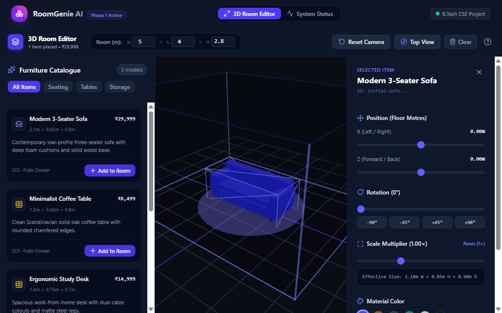
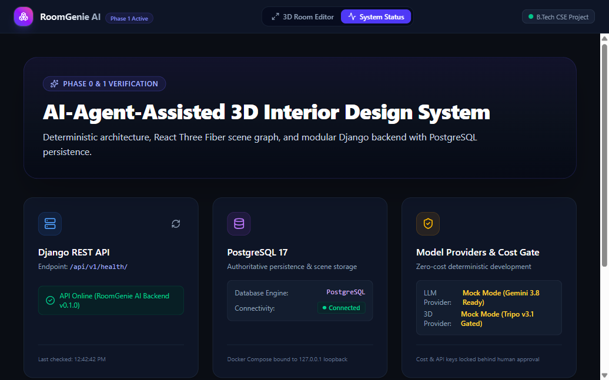
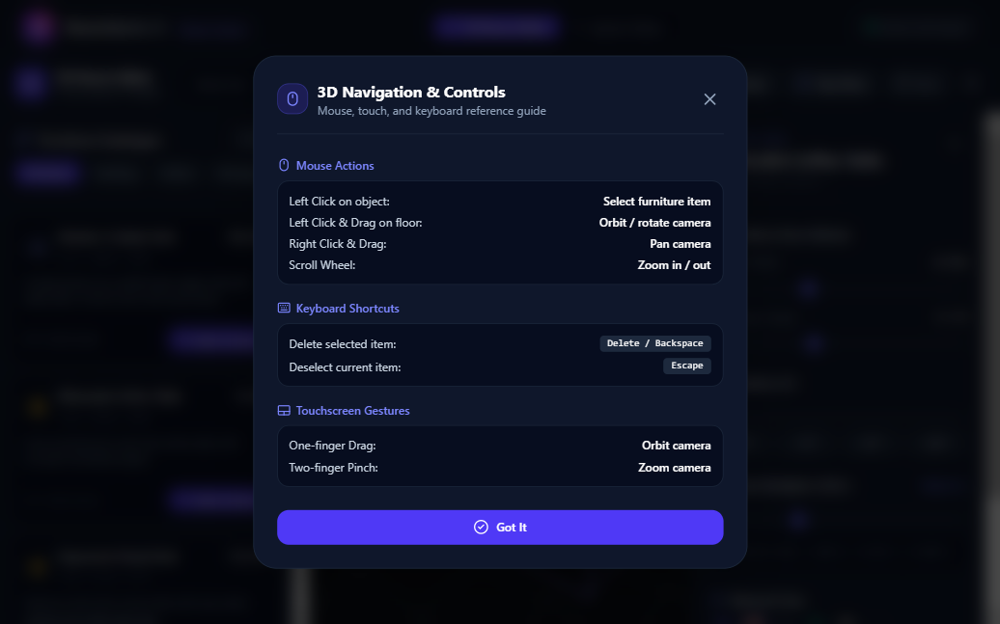
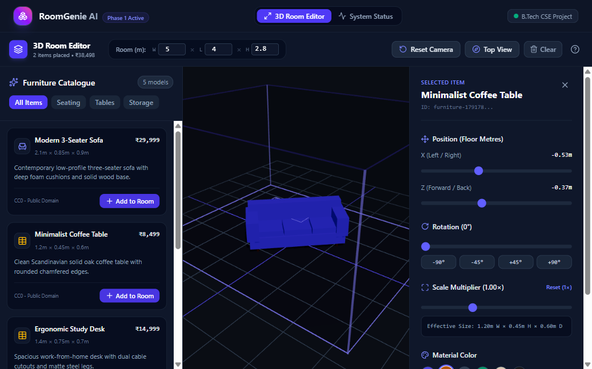
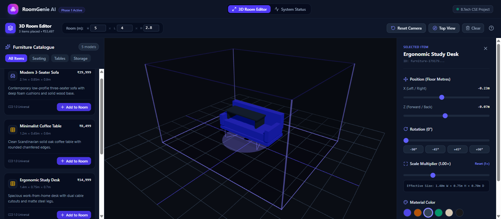
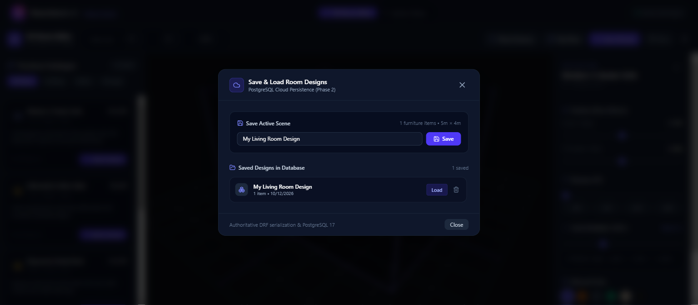
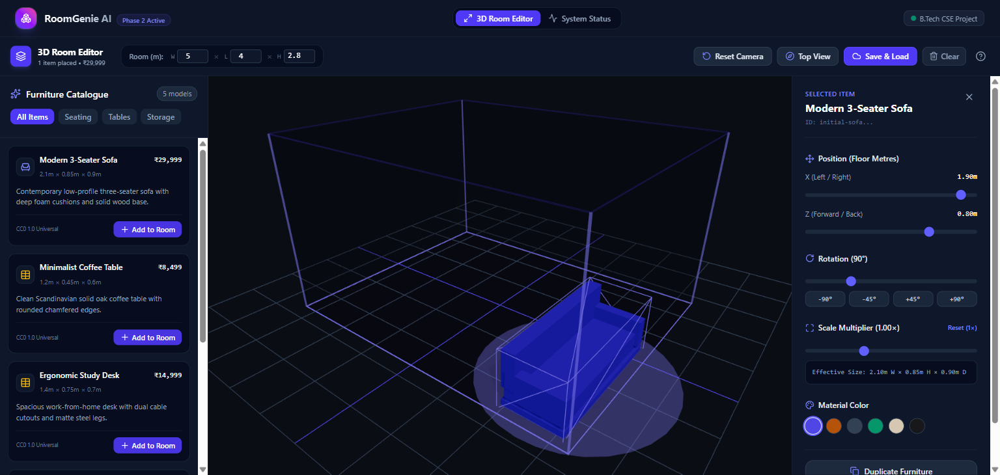
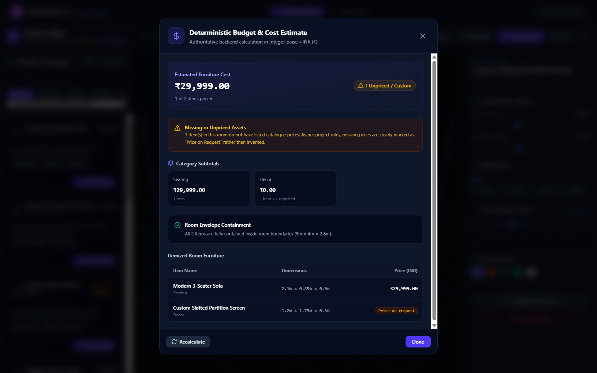
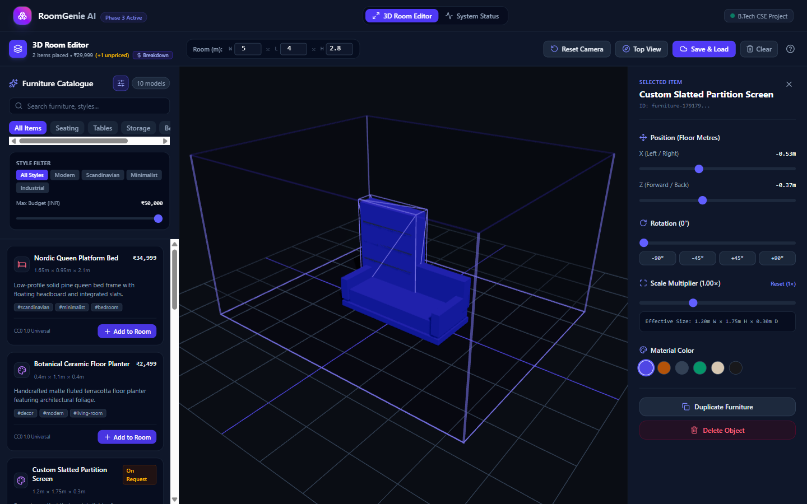

# RoomGenie AI — Browser Verification Screenshots

This document contains live browser verification screenshots captured during Phase 1 testing of RoomGenie AI.

---

## 1. Interactive 3D Room Editor
Interactive Three.js canvas featuring ambient and directional lighting, shadow casting, 1m floor grid, room boundary perimeter posts, furniture catalogue, and transform properties panel.

---

## 2. System Status & PostgreSQL 17 Connectivity
Dynamic dashboard verifying live connectivity to the Django REST API (`/api/v1/health/`) and PostgreSQL 17 database (`Connected`).

---

## 3. Keyboard & Mouse Navigation Guide Modal
User navigation guide modal detailing mouse controls (left-click orbit, right-click pan, scroll zoom), keyboard shortcuts (<kbd>Delete</kbd>, <kbd>Backspace</kbd>, <kbd>Escape</kbd>), and touch gestures.

---

## 4. Multi-Item Placement & Dynamic Budgeting
Multiple furniture items placed within the room boundaries. The counter dynamically tracks placed items and calculates the total catalogue budget in INR (`2 items placed • ₹38,498`).

---

## 5. Three GLB Binary Models Loaded (CC0)
Real binary glTF 2.0 assets (`sofa.glb`, `coffee_table.glb`, `desk.glb`) loaded via React Three Fiber / Drei (`useGLTF`) with material overrides and selection indicators.

---

## 6. Phase 2 Room Design Persistence (PostgreSQL 17 & DRF)
Cloud persistence modal integrating the Django REST Framework `/api/v1/designs/` API with PostgreSQL 17. Users can save active 3D scenes, update snapshots, duplicate plans, and load previously saved designs with full object transform recovery.

---

## 7. Phase 2 Transformed 3D Room Containment & Rotation Clamping
Validation of rotated furniture within room boundaries. When furniture is rotated (e.g. +90° around Y), its complete transformed bounding box (accounting for scale, dimensions, and Euler angles) is calculated and strictly contained within the floor, ceiling, and perimeter walls.

---

## 8. Phase 3 Authoritative Deterministic Budget Breakdown Modal
Authoritative backend budget calculation (`/api/v1/budgets/estimate/`) using integer paise arithmetic. Displays total estimated furniture cost in INR (`₹29,999.00`), category subtotals (`seating: ₹29,999.00`, `decor: ₹0.00`), 3D room envelope containment validation, itemized breakdown table, and explicit handling of unpriced items (`Custom Slatted Partition Screen` marked as `Price on request` rather than invented prices).

---

## 9. Phase 3 Furniture Catalogue Search, Filtering & Multi-Item 3D Placement
Expanded 10-model catalogue featuring keyword search, category tabs (Seating, Tables, Storage, Beds, Decor), style filter pills (Modern, Scandinavian, Minimalist, Industrial), maximum budget slider (INR), CC0 licensing attribution badges, and placed 3D items with live header budget summary (`2 items placed • ₹29,999 (+1 unpriced)`).

