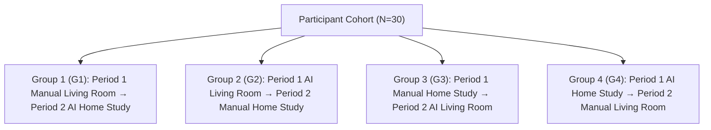

# RoomGenie AI — Academic Supervisor Review Package & Ethics Submission Dossier

**Document Status:** Formal Academic & Institutional Review Submission
**Project Title:** *RoomGenie AI: An AI-Agent-Assisted Interior Design System with Interactive 3D Furniture Placement, Photo-to-3D Reconstruction, and Augmented Reality Visualization*
**Candidate / Principal Investigator:** Gourav Sharma (B.Tech Computer Science & Engineering)
**Repository:** [`https://github.com/GouravSharma26/RoomGenie-ai`](https://github.com/GouravSharma26/RoomGenie-ai)
**Academic Supervisor:** Project Supervisor, Department of Computer Science & Engineering
**Review Target:** Academic Supervisor Endorsement & Institutional Ethics Committee (IRB) Clearance
**Date of Compilation:** October 2026

---

> [!CAUTION]
> **PRE-STUDY GOVERNANCE STATUS: RECRUITMENT STRICTLY PAUSED**
> In compliance with institutional research governance and international research ethics standards (Declaration of Helsinki):
> - **Human-subject participant recruitment and empirical data collection remain strictly PAUSED.**
> - `ENABLE_EVALUATION_TELEMETRY=False` is locked as the server default across all code paths.
> - Software engineering verification (241 Django backend tests and 143 frontend Vitest tests in remote CI) establishes software correctness only; it does **not** constitute ethical clearance or empirical findings.
> - No participant trials will be scheduled or conducted until formal written clearance is issued by the Institutional Ethics Committee and countersigned by the academic supervisor.

---

## 1. Executive Summary & Purpose

This dossier compiles the complete research governance, experimental methodology, statistical analysis plan, data quality protocols, and ethical participant materials for the empirical evaluation of the RoomGenie AI system.

The primary objective of this submission is two-fold:
1. **Academic Supervisor Review & Methodological Alignment:** Present the locked pre-registered experimental design, confirmatory hypotheses, and isolate the three specific statistical modeling choices (`DEC-13`, `DEC-14`, and `DEC-15`) that require formal supervisor direction prior to unblinding study data.
2. **Institutional Ethics Committee (IRB) Clearance:** Provide the complete human-participant protections package, including plain-language Participant Information Sheets (PIS), Informed Consent Forms (ICF) with a 14-day data withdrawal window, data minimization safeguards, and capability-based privacy protections for institutional approval.

---

## 2. Research Protocol & Experimental Design

### 2.1 Research Questions & Confirmatory Hypotheses

The study evaluates whether an interactive AI design agent operating behind a two-phase proposal/approval workflow significantly improves task efficiency, subjective usability, and constraint adherence compared to a standard direct-manipulation 3D room editor.

| Hypothesis | Dependent Metric | Operational Definition | Analysis Method | Pre-Registered Direction |
| :--- | :--- | :--- | :--- | :---: |
| **$H_{01}$ (Task Efficiency)** | `activeDurationSeconds` | Wall-clock elapsed seconds minus detected idle intervals ($\ge 15\text{ s}$). | Linear Mixed Model (LMM) with log-normal / Gamma GLMM fallback | Condition B (AI) $<$ Condition A (Manual) |
| **$H_{02}$ (System Usability)** | `susScore` | Brooke (1996) 10-item System Usability Scale composite score ($0.0–100.0$). | Linear Mixed Model (LMM) with Kenward–Roger / Satterthwaite adjustment | Condition B (AI) $>$ Condition A (Manual) |
| **$H_{03}$ (Budget Compliance)** | `isBudgetCompliant` | Binary indicator: total layout price in integer paise $\le$ task budget ceiling. | Generalized Linear Mixed Model (GLMM, Mixed Logistic) | Condition B (AI) $>$ Condition A (Manual) |
| **$H_{04}$ (Task Success Rate)**| `isTaskSuccessful` | Binary composite: required items present $\land$ budget compliant $\land$ zero doorway keep-out intrusions. | Generalized Linear Mixed Model (GLMM, Mixed Logistic) | Condition B (AI) $>$ Condition A (Manual) |

### 2.2 Study Design & Latin Square Counterbalancing

- **Study Type:** Within-subjects (repeated measures) $2 \times 2$ crossover design.
- **Sample Target:** $N=30$ engineering students/researchers ($60$ total trial observations).
- **Independent Variable:** Workflow Condition:
  - **Condition A (Manual Editor):** Direct manipulation (add, translate, rotate, scale, material swap) in the 3D Three.js canvas. AI Assistant is disabled.
  - **Condition B (AI-Assisted Editor):** Natural language agent drawer proposing structured multi-item layouts with 2-phase visual diff review (`/apply/` or reject) followed by manual fine-tuning.
- **Counterbalanced Sequences:** To prevent condition-order and task-assignment confounding, participants are randomly allocated across four counterbalanced sequences:



### 2.3 Experimental Tasks & Constraint Rubrics

1. **Task 1: Living Room Arrangement:**
   - Budget Ceiling: ₹60,000 (`budget_ceiling_paise = 6000000`).
   - Mandatory Items: Modern 3-Seater Sofa, Coffee Table, TV Console Unit, Lounge Armchair.
   - Spatial Keep-Out: Entry doorway boundary zone ($X \in [-0.60\text{ m}, +0.60\text{ m}], Z \in [0.80\text{ m}, 2.00\text{ m}]$) must remain free of collisions.
2. **Task 2: Home Study Arrangement:**
   - Budget Ceiling: ₹45,000 (`budget_ceiling_paise = 4500000`).
   - Mandatory Items: Executive Desk, Ergonomic Chair, Bookshelf Unit, Floor Lamp.
   - Spatial Keep-Out: Doorway swing clearance zone ($X \in [1.05\text{ m}, 2.25\text{ m}], Z \in [-0.60\text{ m}, 0.60\text{ m}]$).

---

## 3. Statistical Analysis Plan & Decisions Pending Supervisor Review

### 3.1 Primary Model Specifications

For continuous outcomes ($H_{01}$ and $H_{02}$), the primary confirmatory model is formulated as:

$$Y_{ijk} = \mu + \tau_{\text{Condition}(j)} + \pi_{\text{Period}(k)} + \kappa_{\text{Task}(jk)} + u_i + \varepsilon_{ijk}$$

Where:
- $Y_{ijk}$: Observed metric for participant $i$ in condition $j$ during period $k$.
- $\mu$: Overall grand mean intercept.
- $\tau$: Fixed effect of Condition (`manual` vs. `ai_assisted`).
- $\pi$: Fixed effect of Trial Period (`1` vs. `2`) capturing overall learning or fatigue.
- $\kappa$: Fixed effect of Task (`living_room` vs. `home_study`).
- $u_i \sim \mathcal{N}(0, \sigma_u^2)$: Participant random intercept accounting for repeated-measures correlation.
- $\varepsilon_{ijk} \sim \mathcal{N}(0, \sigma^2)$: Residual error.

### 3.2 Multiplicity Control

Family-Wise Error Rate (FWER) across the four primary confirmatory hypotheses ($H_{01} \dots H_{04}$) is strictly controlled at $\alpha = 0.05$ using the **Holm–Bonferroni step-down adjustment**:

$$p_{(1)} \le \frac{0.05}{4} = 0.0125, \quad p_{(2)} \le \frac{0.05}{3} \approx 0.0167, \quad p_{(3)} \le \frac{0.05}{2} = 0.025, \quad p_{(4)} \le 0.05$$

---

### 3.3 Isolated Decisions Pending Supervisor Direction

The following three statistical modeling choices are formally submitted for academic supervisor decision. Until written sign-off is received, each remains strictly classified as `PENDING SUPERVISOR DECISION`:

```text
================================================================================
SUPERVISOR DECISION MEMORANDUM — STATISTICAL MODELING CHOICES
================================================================================
```

#### Decision 1: LMM Denominator Degrees-of-Freedom Approximation (`DEC-13`)
- **Current Dilemma:** Standard asymptotic Wald tests underestimate Type I error in small-to-moderate crossover designs ($N=30$). Satterthwaite approximation estimates effective degrees of freedom via variance component estimation. The Kenward–Roger adjustment incorporates a higher-order small-sample covariance adjustment.
- **Candidate Recommendation:** **Adopt Kenward–Roger adjustment** as primary for $H_{01}$ and $H_{02}$. It provides conservative Type I error protection in $2 \times 2$ repeated-measures models.
- **Status:** **`PENDING SUPERVISOR DECISION`**
  *Supervisor Option:* [ ] Approve Kenward–Roger  |  [ ] Retain Satterthwaite  |  [ ] Specify Alternative

#### Decision 2: Exploratory Individual SUS Item Analysis (`DEC-14`)
- **Current Dilemma:** The pre-registered confirmatory usability hypothesis ($H_{02}$) utilizes Brooke's continuous composite score ($0.0–100.0$). Treating individual 5-point Likert survey items ($Q_1 \dots Q_{10}$) as continuous variables in the primary model violates ordinal boundaries, while running 10 separate confirmatory models induces severe multiplicity penalties.
- **Candidate Recommendation:** **Maintain Brooke composite score as the sole confirmatory hypothesis** in the main thesis text. Analyze individual items $Q_1 \dots Q_{10}$ strictly as exploratory items in Thesis Appendix C using Cumulative Link Mixed Models (CLMM, `ordinal::clmm` in R with logit link).
- **Status:** **`PENDING SUPERVISOR DECISION`**
  *Supervisor Option:* [ ] Approve Appendix CLMM  |  [ ] Omit Individual Item Models  |  [ ] Specify Alternative

#### Decision 3: Model Complexity & Random Slope Structure (`DEC-15`)
- **Current Dilemma:** The pre-registered primary model specifies a random intercept ($u_i$). Adding a condition random slope ($(\text{Condition} \mid \text{Participant})$) allows participant-specific treatment effects, but with only two observations per participant, random-slope variance estimation frequently yields singular fits (`boundary (singular) fit`) in R `lme4`.
- **Candidate Recommendation:** **Retain random intercept model as primary**. Evaluate the random slope specification strictly as a sensitivity analysis; if singular fit occurs, report the singular diagnostic and report the parsimonious random intercept model.
- **Status:** **`PENDING SUPERVISOR DECISION`**
  *Supervisor Option:* [ ] Approve Random Intercept Primary  |  [ ] Mandate Random Slope  |  [ ] Specify Alternative

```text
================================================================================
```

---

## 4. Master Research Decision Register Summary (`DEC-01` – `DEC-21`)

| Decision ID | Domain | Topic / Choice Summary | Operational Status | Approving Authority |
| :---: | :--- | :--- | :---: | :---: |
| **DEC-01** | Architecture | Monolith Django backend; Three.js frontend; no microservices. | `LOCKED` | Implementation Plan |
| **DEC-02** | Coordinate System | Three.js metric coordinates (Y up, X/Z floor plane, 1 unit = 1 metre). | `LOCKED` | Architecture Spec |
| **DEC-03** | Currency & Prices | Integer paise arithmetic (₹1 = 100 paise); zero float math. | `LOCKED` | Architecture Spec |
| **DEC-04** | AI Orchestration | LLM proposes typed tool calls only; client confirms via `/apply/`. | `LOCKED` | Security & Plan |
| **DEC-05** | Foundation Model | Gemini 2.5 Flash behind configurable adapter (`MockLlmAdapter`). | `LOCKED` | Tech Decisions |
| **DEC-06** | 3D Reconstruction | Optional Tripo adapter behind mock; strict glTF validation. | `LOCKED` | Tech Decisions |
| **DEC-07** | AR Deployment | Mobile WebXR on Android target device with desktop QR handoff. | `LOCKED` | AR Spec |
| **DEC-08** | Study Design | $2 \times 2$ Within-Subjects Crossover design ($N=30$). | `LOCKED` | Research Protocol |
| **DEC-09** | Counterbalancing | 4-sequence Latin square allocation (G1–G4). | `LOCKED` | Research Protocol |
| **DEC-10** | Confirmatory Hypotheses| $H_{01}$ (Time), $H_{02}$ (SUS), $H_{03}$ (Budget), $H_{04}$ (Success). | `LOCKED` | Research Protocol |
| **DEC-11** | Multiplicity Control | Holm–Bonferroni step-down procedure ($\alpha_{\text{FWER}} \le 0.05$). | `LOCKED` | Statistical Plan |
| **DEC-12** | Model Framework | LMM for $H_{01}, H_{02}$; GLMM Mixed Logistic for $H_{03}, H_{04}$. | `LOCKED` | Statistical Plan |
| **DEC-13** | LMM Degrees of Freedom | Kenward–Roger adjustment vs. Satterthwaite approximation. | **`PENDING SUPERVISOR`** | Academic Supervisor |
| **DEC-14** | SUS Item Modeling | Composite Brooke SUS confirmatory; individual items in Appendix. | **`PENDING SUPERVISOR`** | Academic Supervisor |
| **DEC-15** | Random Slope Structure| Random intercept primary; random slope sensitivity analysis. | **`PENDING SUPERVISOR`** | Academic Supervisor |
| **DEC-16** | Telemetry Protocol | Granular pause detection ($\ge 15\text{ s}$); spatial AABB clashes. | `LOCKED` | Telemetry Spec |
| **DEC-17** | Missing Data Handling | Completed sessions for primary LMM; partial checkpoints for dropout. | `LOCKED` | Research Protocol |
| **DEC-18** | Exclusion Criteria | Prolonged disruption ($\ge 15\text{ min}$), software crashes, non-compliance. | `LOCKED` | Research Protocol |
| **DEC-19** | Privacy & Retention | Coded IDs (`P01`), 14-day withdrawal right, no audio/video/webcam. | **`PENDING ETHICS`** | Ethics Committee |
| **DEC-20** | Institutional Ethics | Formal Institutional Ethics Review Board clearance application. | **`PENDING ETHICS`** | Ethics Committee |
| **DEC-21** | Export Determinism | 33-column CSV and hierarchical JSON via `export_evaluation_dataset`. | `LOCKED` | Export Spec |

---

## 5. Data Quality Protocol & Export Guide Summary

The dataset integrity pipeline is documented in [`docs/RESEARCH_DATA_QUALITY_CHECKLIST.md`](RESEARCH_DATA_QUALITY_CHECKLIST.md) and [`docs/EVALUATION_DATASET_AND_EXPORT_GUIDE.md`](EVALUATION_DATASET_AND_EXPORT_GUIDE.md). Every quality check is classified by its concrete operational mechanism:

1. **Automated Guarantees (`AUTOMATED (MODEL/API VERIFIED)`):**
   - **Schema Invariance:** 33 CSV columns in canonical order; JSON `schemaVersion = 1`.
   - **Session ID Uniqueness & RFC 4122 Format:** Enforced by PostgreSQL primary-key constraint on `EvaluationSession.id` and DRF `StartSessionSerializer.sessionId`.
   - **SUS Survey Scoring:** Strictly validated Likert domain $\{1,2,3,4,5\}$ with rejection of booleans, floats, and shadowed duplicate keys; Brooke (1996) continuous formula calculated server-side.
   - **Interaction Bounds:** Non-negative database fields (`PositiveIntegerField`) for edits, undo/redo, collision counts, and doorway intrusions.
2. **Dataset-Level Audits (`MANUAL AUDIT` / `FUTURE SCRIPT`):**
   - **UUIDv4 Specificity:** DRF parses standard RFC 4122 UUIDs but does not enforce version 4 specifically at ingestion; compliance is audited post-export via assertion `uuid.UUID(row['sessionId']).version == 4`.
   - **Cross-Trial Balance:** Verifying exactly 2 completed trials per participant across Latin square sequences G1–G4.
   - **Missingness & Anonymization:** Post-export cross-tabulation verifying zero PII in `participantId` and proper null structures in aborted sessions.
3. **Export Determinism & Timestamp Collision Semantics (`DOCUMENTED LIMITATION`):**
   - The export command executes `.order_by('start_time')`. For distinct timestamps, ordering is deterministic.
   - *Documented Limitation:* If multiple records share identical timestamps (e.g. batch fixtures), relational database engines do not guarantee tie-breaker ordering without a secondary sort key. Researchers are instructed to apply secondary sorting by `sessionId` during pre-flight data ingestion.

---

## 6. Draft Ethics Submission Materials

The following materials are prepared for submission to the Institutional Ethics Committee / Institutional Review Board (IRB):

### 6.1 Draft Participant Information Sheet (PIS)

```text
================================================================================
PARTICIPANT INFORMATION SHEET (PIS)
Department of Computer Science & Engineering
================================================================================
Study Title:
Evaluating User Experience and Spatial Design Efficiency in Manual vs. AI-Assisted
Interactive 3D Interior Design

Principal Investigator: Gourav Sharma (B.Tech Candidate, Computer Science & Engineering)
                        Institutional Email: [gourav.sharma.cse@institution.ac.in — Placeholder to be verified]
                        Laboratory: Department of Computer Science & Engineering, Room [Lab No.]
Academic Supervisor:    [Supervisor Name & Academic Title], Department of CSE
                        Institutional Email: [supervisor.cse@institution.ac.in — Placeholder to be verified]
                        Office: Room [Office No.], Department of CSE
Institutional Ethics:   Institutional Ethics Review Board / Research Ethics Office
                        Email: [ethics.committee@institution.ac.in — Placeholder to be verified]
                        Office: Secretariat of Research & Development / Ethics Committee

Study Location:         Department of Computer Science & Engineering Computing Laboratories
Estimated Time:         Approximately 30 to 40 minutes (Single Laboratory Session)

1. Invitation and Study Purpose
You are invited to take part in an academic research study evaluating software interfaces
for 3D interior design. The purpose of this study is to compare how users interact
with an interactive 3D room editor when working manually versus working with the
assistance of an AI design agent that suggests candidate furniture layouts based on
natural-language design prompts.

2. What Will Happen During the Session?
If you decide to participate, you will complete the following sequence in a single session:
  a. Pre-Study Demographic & Background Questionnaire (Approx. 3 minutes):
     You will answer four non-identifying background questions:
     1. Prior experience with 3D modeling / CAD software (5-point ordinal scale: None,
        Novice, Intermediate, Advanced, Expert).
     2. Prior experience with generative AI / conversational agents (5-point ordinal scale:
        Never, Rarely, Occasionally, Frequently, Daily).
     3. Academic program and year of study (e.g., B.Tech CSE 3rd Year; no names or student IDs).
     4. Primary input device preference for CAD work (Mouse & Keyboard vs. Laptop Trackpad).
     (Purpose: These responses serve as control covariates for exploratory subgroup analysis
     to determine if prior CAD proficiency moderates AI assistance effectiveness. Responses
     are indexed solely by your anonymous Participant Code; zero sensitive demographics are collected).
  b. Brief Interface Orientation (Approx. 5 minutes):
     A standard demonstration of the 3D room viewport controls (orbit, pan, zoom, translate, rotate).
  c. Experimental Design Tasks (Two Tasks, Approx. 10–12 minutes each):
     - In one task, you will search a digital furniture catalogue and arrange items manually.
     - In the other task, an AI design assistant will generate initial layout proposals
       that you can visually inspect in a 3D preview, approve, and fine-tune.
     - Both tasks require meeting realistic design constraints (e.g. placing required furniture,
       maintaining an explicit budget ceiling, and keeping doorway clearance keep-out zones clear).
  d. Post-Task Usability Evaluations (Approx. 4 minutes each):
     You will complete a standardized 10-item System Usability Scale (SUS) questionnaire
     following each task.

3. Voluntary Participation & Right to Withdraw
Your participation in this study is entirely voluntary. You may choose not to take part,
or you may stop participating at any time during the session without giving a reason and
without any negative consequences for your academic standing, course grades, or relationship
with the university.

4. Participant Compensation & Academic Credit
Participation in this research study is voluntary. No direct financial remuneration or
cash payment is provided. Subject to departmental approval and ethics committee clearance,
undergraduate students enrolled in eligible CSE department courses may receive optional
course participation credit / extra credit [or specify: No compensation or course credit].
Choosing not to participate, or withdrawing at any point, carries zero penalty and will
not disadvantage your academic standing or course assessment.

5. Confidentiality, Data Protection & Technical Server Logging Disclosures
- All evaluation metrics are indexed strictly by an assigned anonymous Participant Code (e.g., P01).
- No personally identifiable information (such as your full name, student ID, email address,
  phone number, or contact details) will be stored in the research evaluation database or published.
- The recorded data consists strictly of software interaction counts (additions, moves, edits),
  elapsed active duration, placed furniture 3D coordinates, and survey responses.
- ZERO audio recordings, webcam video, eye-tracking, facial imagery, or biometric data are collected.
- Technical Server Logging Disclosure: The application evaluation database does not store IP addresses.
  However, like standard network infrastructure, web server or reverse proxy connection daemons
  may temporarily log network IP addresses for security diagnostics prior to routine log recycling.
  To safeguard participant privacy, laboratory trials will be conducted on designated departmental
  workstations on a monitored lab subnet, and server network logs will never be linked to participant
  evaluation records.

6. 14-Day Post-Trial Data Withdrawal Window
You have the right to request the deletion of your recorded data at any time within
fourteen (14) days following your session. To request data deletion, contact the researcher
or supervisor citing your assigned Participant Code. Following this 14-day window, the code
linkage key is permanently destroyed, rendering all research data irreversibly anonymized.

7. Foreseeable Risks, Discomforts & Mitigations
The foreseeable physical and psychological risks of this study are comparable to ordinary computer work:
- Visual / Screen Fatigue: Viewing a 3D WebGL canvas continuously for 30–40 minutes may cause
  mild eye strain.
- Physical Discomfort: Repetitive mouse clicking, dragging, or typing may cause mild hand or wrist fatigue.
- Cognitive Frustration: Attempting to satisfy tight budget ceilings and spatial keep-out zones within
  the software may induce mild task pressure.
- Confidentiality Risks: Minimized by pseudonymized coding (P01–P30), capability bearer token hashing
  via SHA-256, network isolation, and post-study irreversible anonymization.
Mitigation: You are encouraged to take short pauses between tasks. You may pause, rest, or stop
the session at any time without penalty.

8. Contact for Questions or Concerns
If you have questions regarding this research study or your rights as a participant, please
contact:
- Principal Investigator: Gourav Sharma [Student Institutional Email — To be populated prior to study]
- Academic Supervisor: [Supervisor Name, Department of CSE — To be populated prior to study]
- Ethics Committee Contact: [Institutional Ethics Review Board — To be populated prior to study]
================================================================================
```

### 6.2 Draft Participant Informed Consent Form (ICF)

```text
================================================================================
PARTICIPANT INFORMED CONSENT FORM (ICF)
Department of Computer Science & Engineering
================================================================================
Study Title: Evaluating User Experience and Spatial Design Efficiency in Manual vs.
             AI-Assisted Interactive 3D Interior Design
Principal Investigator: Gourav Sharma (B.Tech Candidate, Computer Science & Engineering)

Please initial each box to confirm your agreement:

[ ] 1. I confirm that I have read and understood the Participant Information Sheet
       dated October 2026 for the above research study.
[ ] 2. I have had the opportunity to consider the information, ask questions, and
       any questions asked have been answered satisfactorily.
[ ] 3. I understand that my participation is voluntary and that I am free to pause or
       withdraw at any time during the session without giving a reason and without penalty.
[ ] 4. I understand the foreseeable risks (such as mild screen fatigue or hand discomfort)
       and understand that I may take breaks as needed.
[ ] 5. I understand that my participation involves no financial remuneration, and any
       optional course participation credit is subject to departmental ethics approval.
[ ] 6. I understand that my data will be pseudonymized using an anonymous Participant Code
       and that I may request deletion of my data within 14 days of participation by citing
       my Participant Code.
[ ] 7. I understand that after the 14-day withdrawal period, code linkage records will
       be destroyed, rendering all research data irreversibly anonymized for thesis
       reporting and scientific dissemination.
[ ] 8. I understand that no audio, video, facial imagery, or biometric data will be captured,
       and that web server access logs are not linked to evaluation records.
[ ] 9. I agree to participate in the above research study.

Participant Name (Printed):  ___________________________________________________
Participant Signature:       _________________________   Date: _________________
Assigned Participant Code:   [ P ____ ] (To be completed by Researcher)

Researcher Signature:        _________________________   Date: _________________
================================================================================
```

---

## 7. Explicit Checklist of Outstanding Approvals & Pre-Study Requirements

Before participant recruitment or data collection can commence, every item on the following checklist must be satisfied:

```markdown
- [ ] 1. Academic Supervisor Written Endorsement:
      Supervisor reviews this package, signs the review memorandum, and records
      authoritative decisions for DEC-13 (Degrees of freedom), DEC-14 (SUS item modeling),
      and DEC-15 (Random slope structure).
- [ ] 2. Institutional Ethics Committee / IRB Submission & Protocol Reference Number:
      Submit formal ethics application containing PIS, ICF, and study protocol;
      obtain written clearance reference number (DEC-20). Reference number must be
      recorded in ETHICS_AND_DATA_GOVERNANCE_GATE.md.
- [ ] 3. Non-Participant Target-Hardware Dry Run (Post-Ethics Precondition):
      Following ethics clearance, execute single synthetic trial (ID: DRYRUN_TEST_01)
      on the physical realme Narzo 70 Turbo 5G device to verify database write latency,
      mobile rendering stability, and export integrity under physical lab Wi-Fi.
- [ ] 4. Telemetry Safeguard Verification:
      Confirm ENABLE_EVALUATION_TELEMETRY=False remains the production default, to be
      enabled solely on isolated lab server during authorized testing hours.
- [ ] 5. Recruitment Authorization:
      Participant recruitment begins strictly after Steps 1–4 are fully signed off.
```

---

## 8. Formal Supervisor Review Memorandum & Sign-Off Block

```text
================================================================================
ROOMGENIE AI — ACADEMIC SUPERVISOR REVIEW & ETHICS SUBMISSION SIGN-OFF
================================================================================

1. Academic Supervisor Review Decisions:
   - Decision DEC-13 (LMM Degrees of Freedom):
     [ ] Approved: Kenward–Roger adjustment
     [ ] Approved: Satterthwaite approximation
     [ ] Other: ________________________________________________________________

   - Decision DEC-14 (Treatment of Individual SUS Survey Items):
     [ ] Approved: Composite Brooke SUS confirmatory; individual items in Appendix C (CLMM)
     [ ] Approved: Composite Brooke SUS only; omit individual item modeling
     [ ] Other: ________________________________________________________________

   - Decision DEC-15 (Model Complexity & Random Slope):
     [ ] Approved: Random intercept primary; random slope sensitivity analysis
     [ ] Approved: Random slope mandated as primary
     [ ] Other: ________________________________________________________________

2. Endorsement for Institutional Ethics Committee Submission:
   "I have reviewed the study protocol, Statistical Analysis Plan, Participant
   Information Sheet, and Informed Consent Form for the RoomGenie AI research project.
   I endorse this dossier for formal submission to the Institutional Ethics Review
   Committee / Institutional Review Board."

Academic Supervisor Signature:  ________________________________________________
Supervisor Name:                ________________________________________________
Department:                     Department of Computer Science & Engineering
Date:                           ________________________________________________

3. Institutional Ethics Committee / IRB Clearance Record:
   Ethics Committee Protocol Reference Number: [ ______________________________ ]
   Date Approval Issued:                       [ ______________________________ ]
   Ethics Committee Chair / Authorized Officer: [ ______________________________ ]
================================================================================
```
